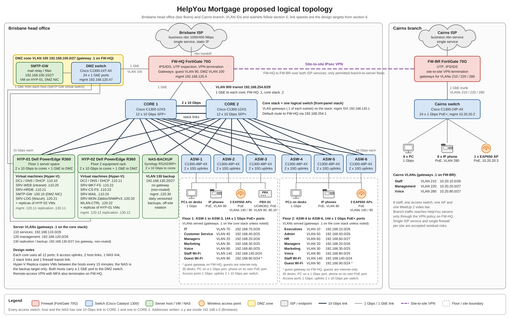
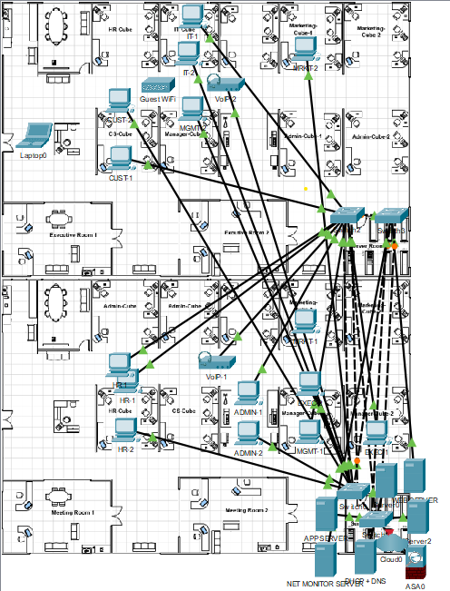
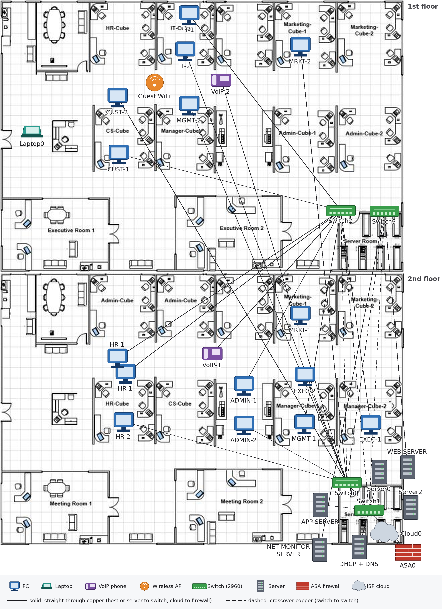
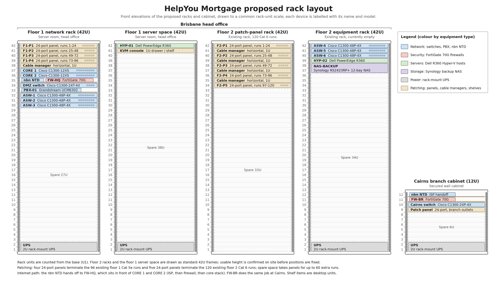

ICTNWK529 Install and manage complex ICT networks

ICTNWK546 Manage network security

Complex Cluster \| Assessment Task 2 of 3

**HelpYou Mortgage Network Infrastructure Proposal**

Prepared by Roly Lobley

Submitted to: Chief Information Officer, HelpYou Mortgage

Date: 7 October 2026

Student number: ________

Assessment due date: ________

# Executive summary

HelpYou is expanding its Brisbane head office from 40 to 70 staff across two floors, with 35 people on each floor, and the eight staff in Cairns need to reach the same systems. Your five-year estimates take the head office to 108 staff and 270 end devices. I propose a network that replaces the slow, flat switching with segmented 1 Gbps access, two 10 Gbps core switches, centralised identity and file services on two virtualisation hosts, protected backups and managed voice and video. The work is staged over the four months the case study allows. [P1, P2]

Each site keeps one internet service. At Brisbane the nbn handoff terminates on a FortiGate 70G firewall that sits directly behind the ISP and in front of the two core switches, so every internet, guest, DMZ and Cairns flow is inspected before it reaches the core stack. The two cores run as one stack over two 10 Gbps links, two domain controllers share identity, DNS and DHCP, and each virtualisation host holds replicas of the other host's services. One firewall and one internet service per site remain an accepted residual risk, which section 2.3 explains.

The first-year cost is $350,601.81, including a 10% implementation contingency and the first year of operating costs, which leaves $149,398.19 of the $500,000 budget. My five-year baseline ownership estimate is $498,211.41, which adds four further years of operating costs and firewall renewals to the first-year figure. Section 6.9 separates the published retail prices from my allowances, and the allowances need supplier quotes before anything is ordered. [P1]

# Introduction

You asked for a network infrastructure proposal that supports the immediate two-floor expansion of the Brisbane head office, connects the Cairns branch, and gives HelpYou centralised DHCP and DNS, company-hosted email, a management server with activity logs, backups, remote access, wireless for staff and visitors, a better telephone service and videoconferencing, all within four months and a $500,000 budget. [P1] This report is my response to that brief.

I have followed the report structure set out in the assessment template [P3]. Section 1 compares the current network with the one HelpYou needs, in a three-column organiser with numbers in every row. Sections 2 to 5 set out the logical topology (Figure 2), the physical layout from my Packet Tracer physical view (Figure 1, with a full-size render as Figure 1b), the rack arrangement (Figure 3) and the IP scheme. Section 6 covers the hardware, software and services I have selected, with make, model, placement and price for each, and the total cost. Section 7 forecasts server bandwidth over the next five years, explains how the design keeps up with it and closes with my conclusion, and section 8 lists my sources.

I started from the case study and the customer interview, built the gap analysis from them, and then designed each layer to close a gap: the firewall and segmentation at the boundary first, then switching, servers, identity, backup and communications. Subnets are sized from your five-year device counts, so the address plan lasts the full five years. For every product I checked the vendor data sheet against the job it has to do and took the price from an Australian retail listing. For configured items such as the servers I have made an allowance and flagged it for a supplier quote.

The current conditions and business requirements come from the HelpYou case study [P1], the department locations, head counts and server bandwidth figures come from the customer interview answers [P2], and the equipment capabilities and prices come from the vendor and retail pages in the bibliography [R1-R30]. The equipment choices, the VLAN and subnet plan, the recovery targets and the bandwidth forecast are my own design work.

Two Packet Tracer files accompany this report. Helpyou_Network_Topology.pkt draws the two core switches, the four existing servers, sample PCs for each department, the DMZ switch, the firewall and the ISP cloud. FLOOR_PLAN_FINAL.pkt places the devices on the two Brisbane floors and is the view in Figure 1 in section 3. Both files show what connects to what with copper cabling, using Cisco 2960 and ASA icons in place of the Catalyst 1300 switches and the FortiGate 70G. The files carry the connectivity, and the addressing, VLAN and security detail lives in the tables of this report.

# 1. Gap Analysis

## 1.1 Current conditions

HelpYou's original Brisbane office had 40 staff: five executives, five managers, five customer service staff, ten administration staff, ten marketing staff, three HR staff and two IT staff. The expansion adds another 30, so the head office grows to 70 staff across two floors, 35 on each, and the Cairns branch has eight. I have used 78 users (70 plus 8) as the starting point for licensing and 116 users (108 Brisbane plus 8 Cairns) as the five-year planning figure, with 270 departmental end devices at the five-year mark. Customer Service and IT sit on floor 1, Executives, Admin and HR on floor 2, and Managers and Marketing are spread across both [P1, P2].

The network itself is two cross-linked 24-port Catalyst 2940 switches, 48 ports in total, with 100 Mbps access ports and one 1 Gbps inter-switch uplink each. Each staff member has a statically addressed PC and an analogue phone, and the PCs and servers all use 100BaseT interfaces. Two extra Linux machines sit alongside the Windows desktops [P1].

Internet arrives through a single ADSL router, and that router is the only device between the office LAN and the internet. The case study lists no firewall, intrusion prevention or DMZ, and the existing firewall, VLAN and RAID settings are undocumented, so I have designed as if the network is flat and unprotected. Four servers carry the business: an internal Web server, the HR database (HR-DB), the Marketing file server (Market-FS) and the Customer Service file server (CS-FS) [P1].

The Web server is short of memory and disk space, and staff report slow access to the other three servers. There are no backups, no redundancy and no remote access, so the Cairns staff have no convenient way to reach head-office systems. Wireless is limited to IT staff, visitors cannot connect reliably, and international calls on the analogue phones are expensive. There is no email server, no monitoring and no central directory [P1].

The building does give me some assets to reuse. Floor 1 already has 96 Cat 5e runs terminating on its server-room patch panels, and the new floor 2 has 120 Cat 6 runs and two racks, one holding patch panels and one empty. That is 216 runs in total, which I will test and certify before I build on them. You have given me four months and a $500,000 budget to deliver the upgrade [P1].

## 1.2 Current system, changes required and the future system HelpYou needs

Table 1 compares the network HelpYou has now with the network the business needs, and sets out the changes I propose to get from one to the other. The left column summarises the current system, the middle column the changes required and the right column the future system the business needs. Each row gives both the qualitative gap, what the business lacks today and why it matters, and the quantities behind it: device counts, port speeds, capacities, model names and costs.

| Current system | Changes required | Future system the business needs |
|---|---|---|
| **Perimeter firewall and security.** One consumer-grade ADSL router is the only device between the office LAN and the internet, so there is no separation between the two. The case study lists no firewall, no intrusion prevention or detection, no DMZ and no VPN, and the existing firewall settings are undocumented, so I treat the boundary as open. The Web, HR-DB, Market-FS and CS-FS servers share the same flat switches as every PC, so anything that reaches the LAN can reach the servers [P1]. | I will install a FortiGate 70G next-generation firewall (FW-HQ) directly behind the Brisbane nbn handoff and in front of the two core switches, so every packet between the internet and the core stack passes through it (ISP to firewall to core). The FortiGuard UTP bundle runs IPS/IDS, web and application filtering and antivirus at the perimeter, and the firewall sends its security events to the Wazuh log server. A DMZ zone (VLAN 100, 192.168.100.0/27) on a separate Cisco C1300-24T-4X switch holds the SMTP mail relay [R30]; the guest VLAN 90 and the DMZ terminate on the firewall, and the core stack connects through one transit link to each core in VLAN 900 (192.168.254.0/29, firewall .1, core stack .2). FW-HQ also terminates the site-to-site VPN from Cairns and MFA remote access for staff, with a second FortiGate 70G (FW-BR) at the branch end. Budget: $2,250 per site in year one ($4,500 for both) and $2,000 a year for UTP renewals from year two [R5, R6]. | One controlled entry point at each site, with every internet flow inspected and every blocked or suspicious event logged for review. The mail relay is isolated in the DMZ, guests and branch users reach only what the policy allows, and the Cairns link and remote staff come in over encrypted, authenticated paths. A single firewall per site is an accepted residual risk. |
| **Core switching.** The two cross-linked 24-port Catalyst 2940 switches act as both core and access layer. Each has one 1 Gbps inter-switch uplink, the rest of its ports run at 100 Mbps, and the four servers hang off those 100 Mbps ports. No VLANs or inter-VLAN routing are documented, so every device shares one broadcast domain [P1]. | I propose two Cisco C1300-12XS core switches, each with twelve 10 Gbps ports (ten SFP+ and two combo copper/SFP+), joined by two 10 Gbps links and run as one front-panel stack so the pair is a single logical switch. Each core carries six access-switch uplinks, two host links, one NAS link, two core-to-core links and one firewall transit link, which uses all twelve ports. The stack holds the department gateways and applies the inter-VLAN access rules. $3,036.73 each, $6,073.46 for the pair [R1, R2]. | A 10 Gbps core that keeps running if one core switch or one interconnect fails, with every server, host and floor uplink on a 10 Gbps path and inter-VLAN routing in one place. |
| **Access switching.** The same two switches give 48 access ports in total, all at 100 Mbps. The 40 PCs and four servers alone take 44 of them, so there is no room for 70 PCs, let alone a powered port for each new IP phone, and staff already report slow access to the servers [P1]. | I propose six Cisco C1300-48P-4X switches, three per floor, giving 288 PoE+ gigabit ports (375 W PoE budget per switch) with four 10G SFP+ slots each. Every switch has two 10 Gbps uplinks, one to each core, so twelve uplinks in total and two spare SFP+ slots per switch. Each desk gets two ports, a 1 Gbps port for the PC and a PoE port for its phone, and the access points draw PoE as well. Cairns gets one C1300-24P-4X (24 PoE ports, 195 W, 17 used and 7 spare). $2,704.42 each for the six ($16,226.52) and $2,003.43 for Cairns [R1, R3, R4]. | 288 Brisbane ports for 276 planned connections (270 devices plus six access points, 12 spare), 1 Gbps to every desk, 10 Gbps uplinks, and each floor keeps a path to the core if one switch or one uplink fails. |
| **Servers and storage.** Four ageing physical servers (internal Web, HR-DB, Market-FS, CS-FS) on 100BaseT interfaces, running Windows 2012 or Linux, plus two further Linux machines. The Web server is short of memory and disk space, and staff find HR-DB and the two file servers slow. CPU, memory, disk sizes and RAID settings are not documented in the case study, and each server is a single box with no replica [P1, P2]. | I will migrate the four services to two Dell PowerEdge R360 virtualisation hosts, HYP-01 on floor 1 and HYP-02 on floor 2. Each has an eight-core processor, 128 GB ECC RAM, redundant power, four 3.84 TB enterprise SSDs in RAID 10 (about 7.68 TB usable), two 10 Gbps ports to the core pair and one 1 GbE port to the DMZ switch. The hosts run 11 virtual servers with 70 GB of RAM in total (SRV-HRDB gets 16 GB, the file servers 8 GB each) against a 4 TB live-dataset planning envelope, and Hyper-V Replica copies each VM to the other host every 15 minutes. Allowance: $18,000 per configured host, $36,000 for the pair [R7, R26]. | Every service has sized CPU, memory and storage with room to grow, either host can carry all 11 servers if the other fails, and a failed service is back within the four-hour recovery target. |
| **Identity, DHCP and DNS.** Every PC carries a manually assigned static address. No domain, DHCP or DNS service is documented, so there is no central login, password policy or permission control, and you have asked for centralised DHCP and DNS [P1, P2]. | My design adds two Windows Server 2025 domain controllers, DC1 on HYP-01 (192.168.110.10) and DC2 on HYP-02 (192.168.110.11), each running AD DS, DNS and DHCP with AD replication and DHCP failover between them. Each VLAN gets its own scope (.10 to .62 in each departmental /26, .10 to .30 for HR, .10 to .126 for Marketing and Customer Service) with reservations for printers and phones. AD groups control every share and login, and 78 User CALs cover the users ($8,537.10) [R8-R10, R28]. | One login per person, central password and permission control, automatic addressing with no conflicts, and domain services that keep running if one host is lost. |
| **Network monitoring and logging.** There is no monitoring server and no log collection, so faults surface only when staff report them, and there is no record of who accessed what. You have asked for a dedicated management server and activity logs [P1, P2]. | I will deploy Zabbix on SRV-MON (192.168.120.20) to poll every switch, firewall, host and server over SNMPv3 and alert at 70% interface use, 70% CPU, 80% memory and 25% free storage. Wazuh on SRV-LOG (192.168.120.21) collects security events from the firewall, servers and domain controllers, keeping 90 days searchable and 12 months archived. Both are self-hosted open source at $0 licence cost [R21, R22, R29]. | Faults and misuse detected before staff notice them, capacity trends visible month to month, and an auditable record of who accessed what. |
| **Endpoint protection and anti-virus.** No managed endpoint protection is documented. The desktops run a mix of Windows versions, so nobody has a central view of what is protected or patched [P1]. | I have selected Microsoft Defender for Business for the 78 users ($4,633.20 a year) and the servers add-on for 14 server instances, being the 11 virtual servers, the two Hyper-V hosts and one spare ($831.60 a year), $5,464.80 a year combined. Central alerts, tamper protection, automatic investigation and scheduled patching run from one console, and I use the ASD Essential Eight as the baseline for the surrounding controls [R11, R27]. | Every PC and server protected, patched and reported under one console, with a documented security baseline. |
| **Backup and disaster recovery.** No backups and no redundancy of any kind. A failed disk or a deleted file means permanent data loss, and there is no plan for losing the site [P1]. | I will install a Synology RS2423RP+ 12-bay NAS ($6,124.25, plus $6,000 for drives, rails and off-site media) with six 8 TB drives in RAID 6 (about 32 TB) on the isolated backup VLAN 130, and run daily versioned backups of every VM and share. Four removable encrypted off-site targets rotate weekly ($1,200 a year custody), I test a restore every quarter and I run a full recovery rehearsal every year. RAID 10 on each host and Hyper-V Replica between the hosts cover disk and host failure [R12, R13, R26]. | Deleted files, failed servers and loss of the whole site are all recoverable, with an off-site gap of one business day at most and restores proven by regular testing. |
| **Internet service.** One ADSL service with recurring disconnections, shared by the whole office; its speed is not documented in the case study. Every cloud service, the email and the future VPN would depend on it [P1]. | I have chosen Aussie Broadband Business Assurance Ultrafast Plus 1000/400 (875/339 Mbps typical busy period) with a static IP and nbn Gold eSLA restoration at $160 a month ($1,920 a year) for Brisbane, and I allow $120 a month ($1,440 a year) for a business plan at Cairns [R24]. | Stable internet for cloud services, Teams, the VPN and email, with the forecast WAN demand of about 181 Mbps down and 131 Mbps up sitting well inside the plan. One service per site, so an outage is an accepted residual risk. |
| **Remote access and branch connectivity.** No remote access for staff and no link between Cairns and the Brisbane servers, so the eight Cairns staff have no convenient way to reach head-office systems [P1]. | I will build a site-to-site IPsec VPN between FW-BR at Cairns and FW-HQ at Brisbane that carries only the permitted branch-to-server flows, and a remote-access VPN on FW-HQ with MFA ($2,500 setup, $500 a year) and role-based rules [R5]. | The eight Cairns staff and authorised remote staff reach approved resources only, over an encrypted path, with every session authenticated by password and a second factor. |
| **VLANs and segmentation.** One flat network with no VLANs documented. Every PC can reach every server and every other PC, so HR records and client files have no network boundary around them [P1]. | My design has 18 VLANs: departments 10 to 70, voice 80, guest 90, DMZ 100, services 110, management 120, backup 130, staff Wi-Fi 140, Cairns 210, 220 and 280, and transit 900. Each subnet is sized from the interview figures (Customer Service with 50 devices in a /25, HR with 20 devices in a /27), and inter-VLAN rules are applied on the core stack and the firewall. | HR data reachable only by HR and administrators, guests internet-only, management interfaces reachable only from IT devices, and each department addressed from its own subnet. |
| **Wireless.** Wireless exists for IT staff only, and visitors cannot connect reliably. The number and model of the existing access points are not documented in the case study [P1]. | I will install seven TP-Link EAP650 Wi-Fi 6 access points, six across the two Brisbane floors and one at Cairns (7 x $179 = $1,253), with a WPA3-Enterprise/802.1X staff SSID on VLAN 140 (150 addresses allowed) and an isolated guest SSID on VLAN 90, managed from the WLAN-CTRL controller. A coverage survey fixes the final positions [R19, R20]. | Staff mobility on both floors and at Cairns, and guest access that never touches company data. |
| **Voice and video.** Analogue phones on every desk, expensive international calls and no videoconferencing between Brisbane and Cairns. No call-cost baseline was supplied in the case study [P1]. | I have selected a Grandstream UCM6302 IP PBX ($462) and 82 GRP2612P PoE phones ($83 each, $6,806; 78 deployed and four spare) on voice VLANs 80 and 280, a SIP trunk sized for ten simultaneous external calls ($600 a month allowance), Teams Essentials for 78 users ($6,177.60 a year) and three Logitech MeetUp 2 video bars ($4,797) for two Brisbane meeting rooms and one at Cairns [R14-R18, R25]. | Internal and branch calls stay on the LAN and VPN, external calls go out over SIP at lower rates, and each site has a meeting room with video. |
| **Email.** There is no email server among the four existing servers, and you want email hosted on HelpYou's own infrastructure [P1]. | I will build SRV-MAIL (Ubuntu Server LTS with Postfix and Dovecot, 8 GB RAM) in the services VLAN 110 and an SMTP-GW relay and filter (2 GB) in the DMZ VLAN 100, so inbound mail is filtered before it touches the internal server, and back the mailboxes up to the NAS [R23]. | Company-hosted email with spam and malware filtering, controlled inbound and outbound paths and recoverable mailboxes. |
| **File sharing.** Staff keep their files on their own PCs, so nothing is shared, protected, versioned or backed up, and the Linux machines need access to the same files [P1]. | Business files move to SRV-MKT-FS and SRV-CS-FS (8 GB RAM each) as SMB shares with AD group permissions and change auditing. I keep the HR database on its own server, SRV-HRDB (16 GB RAM), with HR-only access, and serve both Windows and Linux clients over authenticated SMB [P1]. | Central, backed-up files with need-to-know access, reachable from both platforms, and a record of who changed what. |
| **Cabling, racks and physical layout.** 96 Cat 5e runs on floor 1 terminate on the server-room patch panels; floor 2 has 120 Cat 6 runs and two racks, one with patch panels and one empty; 216 runs in total. Test results and labelling are not documented in the case study [P1]. | I will test and certify the 216 runs, relabel the patching and add up to 60 runs to reach 276 connections. The floor-1 network rack takes the patch panels, CORE 1, CORE 2, FW-HQ, the DMZ switch, the PBX, three access switches and a UPS, with HYP-01 in the floor-1 server space; the floor-2 racks take the patch panels, three access switches, HYP-02, the NAS and a UPS; Cairns gets a small secured cabinet. Allowances: $6,000 cabling, $7,000 UPS and rack fit-out, $6,500 optics and accessories. | A documented, labelled two-floor layout with spare outlets and rack space for growth. |
| **Capacity and growth.** 40 staff growing to 70 now (35 per floor) plus eight at Cairns. The servers already peak at their 100 Mbps interfaces: Web 100 Mbps, Marketing FS 100, HR-DB 80 and CS-FS 60 [P1, P2]. | I have sized the design for 108 Brisbane staff and 270 devices over five years, planning for five-year peaks of Web 300, HR-DB 300, Marketing FS 220 and CS-FS 400 Mbps against a 1 Gbps benchmark per service and 10 Gbps host paths, and I will review capacity monthly against the 70% interface, 70% CPU, 80% memory and 25% free-storage triggers. | Five years of growth to 116 users and 270 devices without re-cabling or replacing switches, with the busiest forecast service using 40% of its benchmark. |
| **Operating systems and licensing.** A mix of Windows desktop versions, two Linux machines and servers on Windows 2012 or Linux. Licensing is not documented in the case study [P1, P2]. | I will standardise the servers on Windows Server 2025 Standard, with six 16-core packs ($10,466.70) so either host can run all six Windows guests, 78 User CALs ($8,537.10), and Ubuntu Server LTS for mail, monitoring, logging and the wireless controller. The endpoint fund of 78 x $1,500 = $117,000 pays for standardised desktops, and $8,000 is set aside for HR application compatibility [R8-R10, R28]. | Supported, licensed and patchable builds on every desktop and server, with the licence position recorded. |
| **People and training.** Staff need training on the account software, and the two IT staff support the whole office by hand, with no directory, monitoring or documented configuration to work from [P1]. | I include 160 hours of design, installation and migration labour ($24,000) and $5,000 for staff and IT training and handover, with diagrams, the static-IP register and support records issued at acceptance. | Staff trained on the new systems, and an IT team with the tools and documentation to run the network day to day. |
| **Timeframe and budget.** You have given the project four months and a $500,000 budget [P1]. | I will deliver in four stages: discovery in month 1, build and pilot in month 2, migration in month 3 and acceptance in month 4. The cost is $350,601.81 in year one (initial $286,999.46 plus 10% contingency and $34,902.40 operating); $149,398.19 remains of $500,000. | A working network delivered inside the four months and the $500,000 budget, with CIO sign-off at acceptance. |

*Table 1. Gap analysis: current infrastructure, changes required and the future infrastructure HelpYou needs.*

The current column draws on the case study and the customer interview [P1, P2]. The figures in the middle column come from the vendor and retail pages cited in each row, and section 6 costs them in full.

# 2. Logical Topology

My logical design for Brisbane is one nbn service, one perimeter firewall, two core switches and six floor-based access switches. The Brisbane nbn handoff terminates on the WAN port of FW-HQ, a FortiGate 70G, which sits directly behind the ISP and in front of the two core switches; every flow to or from the internet, the DMZ, the guest network and Cairns passes through it before it reaches the core stack. The core stack connects to the firewall's LAN side over the VLAN 900 transit (192.168.254.0/29), and the stack's default route points at the firewall's address, 192.168.254.1. Every packet between the LAN and the internet therefore crosses the firewall and its IPS/IDS inspection. Cairns has the same arrangement on a smaller scale: the branch nbn service terminates on FW-BR, a second FortiGate 70G, which fronts the branch switch and carries the site-to-site VPN back to FW-HQ.

Behind the firewall, CORE 1 and CORE 2 are joined by two 10 Gbps links and run as one stack. Each access switch carries several departmental VLANs, so the three switches on a floor serve every department on that floor and I avoid a separate switch per department. The VLAN numbers and subnets in this section are the ones I allocate in section 5, and the link table below gives the capacity of each connection.

| Connection | Purpose and capacity |
|---|---|
| Brisbane ISP handoff -> FW-HQ | One 1000/400 Mbps business nbn service; FW-HQ is the WAN, IPS/IDS and VPN boundary. |
| FW-HQ -> core pair | One 1 GbE transit link to each core in VLAN 900 (192.168.254.0/29); the core stack's default route points at 192.168.254.1. |
| CORE 1 <-> CORE 2 | Two 10 Gbps links, run as a supported stack so the pair is one logical switch. |
| Each access switch -> core pair | Two 10 Gbps uplinks per switch, one to each core; 1 Gbps PC access ports; PoE ports for phones and APs. |
| HYP-01 / HYP-02 -> core pair | Two 10 Gbps links per host, one to each core, carrying the service, management and backup VLANs; a separate 1 GbE link from each host to the DMZ switch for the SMTP gateway. |
| FW-HQ -> DMZ switch -> SMTP-GW | Separate firewall zone (VLAN 100) for the mail relay. |
| Cairns LAN -> FW-BR -> VPN -> FW-HQ | One branch internet service and a site-to-site VPN; only the required branch-to-server flows are permitted. |

*Table 2. Connections and link capacities in my design.*

Figure 2 draws the whole design on one page, with the VLAN IDs, subnets and link speeds marked on it.

*Figure 2. Proposed logical topology for HelpYou Mortgage.*

The diagram follows the path a packet takes. The nbn handoff (1000/400 Mbps) enters FW-HQ, which carries the IPS/IDS and VPN roles. The VLAN 900 transit then leads to CORE 1 and CORE 2, joined by their two 10 Gbps links. The six access switches hang off the cores, each with two 10 Gbps uplinks.

The access switches carry the departmental VLANs: 10 Executives (192.168.10.0/26), 20 Managers (192.168.20.0/26), 30 Marketing (192.168.30.0/25), 40 Customer Service (192.168.40.0/25), 50 Admin (192.168.50.0/26), 60 HR (192.168.60.0/27) and 70 IT (192.168.70.0/26). Voice runs on VLAN 80 (192.168.80.0/25) and staff Wi-Fi on VLAN 140 (192.168.140.0/24). Guests sit on VLAN 90 (192.168.90.0/24), with their gateway on the firewall, so a visitor's traffic goes straight out to the internet.

On the server side, HYP-01 on floor 1 and HYP-02 on floor 2 each connect to both cores at 10 Gbps. Those links carry the services VLAN 110 (192.168.110.0/26), the management VLAN 120 (192.168.120.0/26) and the backup VLAN 130 (192.168.130.0/27). DC1 runs on HYP-01 and DC2 on HYP-02, so domain logon, DNS and DHCP keep working if either host is lost. SRV-MON, my Zabbix monitoring server at 192.168.120.20, polls every switch, firewall, host and server over SNMPv3. NAS-BACKUP connects to both cores, with its backup-data interface on the isolated VLAN 130.

The DMZ switch hangs off FW-HQ on VLAN 100 (192.168.100.0/27), with its gateway on the firewall, and holds SMTP-GW. A 1 GbE link from each host reaches the DMZ switch, so the gateway and its replica can both run there. Cairns appears as its own site: FW-BR, the C1300-24P-4X access switch and one access point on VLANs 210, 220 and 280 (10.20.10.0/26, 10.20.20.0/27 and 10.20.80.0/27), joined to Brisbane by the site-to-site VPN.

The diagram shows two kinds of redundancy. In the infrastructure, the two core links and the stack mean that a failed core switch or a failed interconnect still leaves every access switch, both hosts and the firewall with a working path. In the services, two hosts, two domain controllers, Hyper-V replicas of every application VM and a separate NAS mean that a failed host or a deleted file is recovered from a copy that already exists.

My Packet Tracer topology file (Helpyou_Network_Topology.pkt) is the companion to this diagram. It draws the two core switches with their first interconnect, the four existing servers, sample PCs for each of the seven departments, the DMZ switch, the firewall and the ISP cloud, with the firewall cabled to the ISP cloud. Packet Tracer has no Catalyst 1300 or FortiGate models, so the cores are drawn with 2960 icons and the firewall with an ASA icon. The file shows what connects to what with copper cabling, and the configuration detail sits in sections 2 and 5. The second core link and the firewall-to-core transit links are drawn in Figure 2.

## 2.1 Security zones and service access

Each departmental VLAN reaches the internal services its staff need and stops there. The HR database answers only to the HR group and authorised administrators, and Marketing and Customer Service each have their own file shares and permissions. Every corporate client can reach domain authentication, DNS and DHCP, while administration of those services stays with IT. [P1, P2]

The existing Web role stays an internal intranet, as the case study specifies. The SMTP gateway sits in the DMZ as a relay and filter, so inbound mail is inspected before it reaches SRV-MAIL in the services VLAN. Guest traffic goes straight to the internet and is isolated from company subnets and from other guests. Management interfaces answer only to approved IT administrative devices. FW-HQ runs IPS/IDS on every flow that crosses the perimeter, including the DMZ, the guest network and the VPN. [P1, R5]

The two C1300-12XS cores run as a managed front-panel stack, so they behave as one logical switch and one routing system. Every departmental gateway is an interface on the stack, and the two interconnects carry stack traffic between the members. During the build I will confirm the dual-link stacking and loop prevention on the real hardware, and the month-4 acceptance tests include pulling one core link while traffic is running. [R1]

## 2.2 Server services and redundancy

The table below sets out where each service runs and how it is protected. I have split the services across the two hosts so that each host carries roughly half the load. The two domain controllers sit on different hosts, as do the mailbox server and its SMTP gateway, and the monitoring and logging servers.

| Service or device | Runs on | Resilience and security |
|---|---|---|
| DC1 (AD DS, DNS, DHCP) | HYP-01 | DC2 on the other host; AD and DNS replication and DHCP failover between the two. |
| DC2 (AD DS, DNS, DHCP) | HYP-02 | A second live domain-service instance that answers logons, DNS and DHCP in its own right. |
| SRV-WEB (internal intranet) | HYP-01 | Services VLAN 110; replica on HYP-02 and application-consistent backup. |
| SRV-HRDB | HYP-01 | HR-only application access; replica on HYP-02 plus vendor-supported database backup. |
| SRV-MKT-FS / SRV-CS-FS | HYP-02 | Separate shares and permissions; replicas on HYP-01 and versioned backup. |
| SRV-MAIL / SMTP-GW | HYP-02 / HYP-01 | Mailbox server in VLAN 110; relay and filter in the DMZ; controlled SMTP path and replicas on the opposite host. |
| SRV-MON / SRV-LOG | Opposite hosts | Zabbix for availability and capacity; Wazuh for central security events; both backed up to the NAS. |
| WLAN-CTRL / NAS-BACKUP | HYP-02 / physical NAS | Controller configuration backed up; the NAS holds backups only, while live VMs stay on each host's RAID 10 SSDs. |

*Table 3. Where each service runs and how it is protected.*

I use Hyper-V Replica to keep a recoverable copy of every application VM on the other host, replicating every 15 minutes, with a four-hour recovery-time target. Failover is a manual, verified step: an IT administrator confirms the primary host is down, starts the replica and checks the service before users are pointed at it. Application-consistent backups of the HR database continue alongside replication. Each host is sized to run all 11 services on its own after the other fails, and I will prove that in the acceptance tests. [R26]

RAID 10 on each host covers a failed disk. Deletion, corruption and loss of the building need a separate answer, so the NAS takes a daily versioned backup of every VM and share, and four encrypted removable targets rotate off site each week. My targets are an off-site gap of one business day at most and a documented restoration exercise every quarter. I would like you to confirm the retention and recovery targets before the build starts. [R27]

## 2.3 Single points of failure I have accepted

Each site keeps a single firewall, a single internet service and a single PBX, and the two-floor Brisbane building is one shared site. The two core links protect the LAN from a switch or cable failure; an ISP outage or a failed firewall still takes the site offline until the service is restored or the unit is replaced. I have accepted those risks for this budget and covered them with saved device configurations, a supplier replacement arrangement for the firewall, tested recovery and off-site copies, so a failure becomes a short, planned recovery. If HelpYou later needs uninterrupted internet or telephony, a second service and a second firewall at Brisbane would be the next investment.

# 3. Physical Topology

Figure 1 is my Packet Tracer physical view of the two Brisbane floors, drawn on the floor plan you supplied. I set the plan as the workspace background and stacked it twice. The top half is the first floor, with Executive Room 1 and 2, and the bottom half is the second floor, with Meeting Room 1 and 2. Each floor has its own server room on the right-hand side. Figure 1b is the same layout rendered at full size from the device positions and cable list in my Packet Tracer file (FLOOR_PLAN_FINAL.pkt), so every label stays readable when the report is printed.

*Figure 1. My Packet Tracer physical view: first floor (top) and second floor (bottom) on the supplied floor plan.*

*Figure 1b. The same physical layout rendered at full size from my Packet Tracer file.*

Packet Tracer's device library stops at the Cisco 2960 switch and the ASA firewall, so those icons stand in for the proposed Catalyst 1300 switches and the FortiGate 70G. The drawing shows what connects to what, with copper cabling. The VLAN, address and security detail for each device lives in sections 2 and 5.

On the first floor, IT-1 and IT-2 sit in the IT cube at the top of the plan and CUST-1 and CUST-2 in the Customer Service cube. MGMT-2 is in the manager cube beside them and MRKT-2 in the marketing cube at the top right. The guest Wi-Fi access point sits in the corridor between the two rows of cubicles, VoIP-2 is the floor's sample handset, and a laptop near the entry door stands for a visitor's device.

On the second floor, HR-1 and HR-2 sit in the HR cube on the left and ADMIN-1 and ADMIN-2 in the centre of the floor beside the copier column. MRKT-1 is in the marketing cube at the top right, EXEC-2 and MGMT-1 in the cube below it and EXEC-1 in the cube beside them, with VoIP-1 as that floor's handset. Each department is drawn as a sample of one or two PCs; the full head counts drive the subnet sizes in section 5.

The second-floor server room holds the server cluster: six server icons (WEB SERVER, DHCP + DNS, NET MONITOR SERVER, APP SERVER, Server0 and Server2) and two switches, Switch0 and Switch1. The ISP cloud (Cloud0) sits at the bottom of the room and the firewall (ASA0) sits between the cloud and Switch1. The drawn path is therefore ISP, then firewall, then switch, which is the placement I describe in section 2.

The first-floor server room holds the other two switches, Switch2 and Switch3. Four of the servers cable to Switch1 and the other two, WEB SERVER and NET MONITOR SERVER, cable up to Switch3. The firewall and four of the server icons sit just past the plan's edge at the bottom right, next to the second-floor server room, where there was room to label them.

Every cable in the drawing is copper, and every desk cable runs straight back to a switch in one of the two server rooms. That star layout is the one the production build keeps. The four switches are cross-connected on their gigabit ports, so each floor's pair reaches the other floor's pair, and the two switches on each floor are joined to each other; Figure 1b draws these switch-to-switch cables dashed. I drew two switches per floor to show the pattern. The production build has the two core switches and six access switches of Figure 2, placed in the racks described in section 4.

In the building itself, the 96 existing Cat 5e runs on floor 1 already terminate on the first-floor server-room patch panels. The 120 Cat 6 runs on floor 2 terminate in the patch-panel rack there, which makes 216 runs in total [P1]. Each floor's outlets patch across to the three access switches in that floor's rack. Each access switch then has two 10 Gbps uplinks, one to each core in the floor-1 network rack, and the floor-2 uplinks run down to floor 1 on SFP+ links covered by the optics allowance in section 6.9. I will test and certify the existing runs before cutover and add new runs only where the port count in section 4.1 calls for them.

Department placement follows the customer interview: Customer Service and IT on floor 1; Executives, Admin and HR on floor 2; Managers and Marketing split across both floors, with 35 staff on each floor [P1, P2]. The room names printed on the supplied plan are the building's own labels, so the cubicle a department occupies follows this allocation rather than the printed name. Six ceiling-mounted access points across the two floors carry the staff and guest Wi-Fi. The single Guest WiFi icon in the first-floor corridor stands for them, and I will fix their final positions after the coverage survey in section 6.8.

# 4. Racks Diagram

Figure 3 is my proposed rack layout, drawn as front elevations to one rack-unit scale: the floor-1 network rack, the floor-1 server space, the floor-2 patch-panel rack, the floor-2 equipment rack and the Cairns cabinet. I use the existing server-room rack space on both floors. Floor 2 already has one rack of patch panels and one empty equipment rack, and both are reused as they stand [P1]. In every rack the patching sits at the top, the network equipment below it and the heavier servers and the UPS lower down, so a technician can work on the patching without reaching past a server.

*Figure 3. Proposed rack layout for both Brisbane floors and the Cairns cabinet.*

Reading the floor-1 network rack from the top, four 24-port patch panels terminate the 96 Cat 5e runs, followed by a cable manager and then CORE 1 and CORE 2. Directly under the cores is a shelf holding the nbn NTD and FW-HQ side by side, so the internet path runs from the NTD into the firewall and on to the cores within three rack units. Below them sit the DMZ switch, PBX-01 on its own shelf and the three floor-1 access switches, ASW-1 to ASW-3. A 2U UPS sits at the base and 27U stay spare for growth. HYP-01 takes the top of the floor-1 server space, with a KVM drawer beneath it and its own UPS at the base.

On floor 2, five 24-port panels in the existing patch-panel rack terminate the 120 Cat 6 runs, with a cable manager between each pair of panels. The equipment rack that is empty today takes ASW-4 to ASW-6, HYP-02, the 2U NAS-BACKUP and a UPS, leaving 34U spare. The Cairns cabinet is a 12U secured wall cabinet holding the nbn NTD, FW-BR, the C1300-24P-4X branch switch, a 24-port patch panel for the branch outlets and a UPS, with 6U spare. The table below summarises each rack.

| Rack | Equipment from top to bottom | What it does |
|---|---|---|
| Floor 1 network rack | Patch panels and cable management; CORE 1; CORE 2; FW-HQ on a shelf with the nbn NTD; DMZ switch; PBX on a shelf; the three floor-1 access switches; UPS at the base. | WAN security, the two core interconnects, floor-1 access and telephone control. |
| Floor 1 server space | HYP-01; labelled service, management and backup connections; spare expansion space; UPS-backed power. | First domain controller and the first application-host workload. |
| Floor 2 patch-panel rack (existing) | Retained patch panels; labelled outlets and cable management. | Terminates the existing floor-2 horizontal cabling. |
| Floor 2 equipment rack (existing, empty today) | The three floor-2 access switches; HYP-02; NAS-BACKUP; spare space; UPS at the base. | Second domain controller, recovery host and the separate backup appliance. |
| Cairns secured cabinet | ISP handoff, FW-BR, branch access switch and UPS; local patch termination. | Branch VPN, workstation and phone access, and controlled management. |

*Table 4. Rack contents from top to bottom.*

Rack access is restricted to authorised IT staff. Every patch lead is labelled with its floor, panel and outlet, and every device label matches Figure 2 and the static-IP register in section 5.1. During installation I will check the power loading, earthing, ventilation and UPS runtime of each rack, and confirm the usable height of the floor-2 racks on site before the final rack-unit positions are fixed. Putting one host on each floor means a local problem on one floor, such as a failed air-conditioner, leaves the other host running. Both floors share one building, so the off-site backup copies in section 2.2 remain the protection against loss of the site.

## 4.1 Port and outlet provision

Six 48-port access switches, three per floor, give Brisbane 288 copper access ports (6 x 48 = 288). Your five-year forecast is 270 departmental end devices. Each desk uses two access ports, one for the PC and one for its phone; the 270-device forecast already counts the phones, which is why 270 devices plus six access points come to 276 ports. Each PC keeps its own 1 Gbps port and each phone its own PoE port, so the phone's 100 Mbps pass-through port stays unused. That leaves 12 spare ports across the six switches [P1, P2].

The uplinks use the SFP+ slots on each switch, two of its four, so they take none of the 48 copper ports and two 10 Gbps slots remain on every access switch. The building has 216 horizontal runs today (96 on floor 1 and 120 on floor 2). If every planned connection is wired, up to 60 further runs are needed (276 minus 216), and the $6,000 cabling allowance in section 6.9 covers them [P1, P2].

The 24-port C1300-24P-4X at Cairns serves eight PCs, eight phones and one access point, 17 ports used and seven spare. Its PoE budget powers the phones and the access point, and the spare ports leave room for a branch printer, the meeting-room video PC and a few extra desks.

# 5. IP Scheme

This section sets out the private IPv4 addressing for every VLAN in my design, and the fixed addresses I assign to the servers, the network equipment and the other devices that need one. The departmental host requirements come from the interview handout; the sizes of the supporting zones (voice, guest, DMZ, services, management, backup, staff Wi-Fi and transit) are my own allowances. [P2] VLAN numbers follow the department order 10 to 70, then 80 voice, 90 guest, 100 to 140 services, 210 to 280 Cairns and 900 transit. For Brisbane I have made the third octet match the VLAN number, so VLAN 30 is 192.168.30.0 and VLAN 120 is 192.168.120.0, which makes a packet capture or a routing table easy to read. Cairns uses the 10.20.0.0 range so that branch routes stand out on both firewalls and across the VPN. Figure 2 in section 2 carries the same VLAN numbers and subnets; my Packet Tracer drawings show what connects to what, and the addressing lives in the two tables here.

I sized each subnet from its five-year device count and rounded up to the next prefix that leaves headroom. Executives (30 devices), Managers, Admin and IT user devices (40 each) sit in /26 networks with 62 usable addresses. A /27 would give Executives only 30 usable addresses, and the gateway takes one of them, so a /26 is the smallest prefix that fits. Marketing and Customer Service each forecast 50 devices, so I have used /25 networks with 126 usable addresses, which leaves both departments room to keep growing past the five-year figure. HR, at 20 devices, fits a /27 with 30 usable addresses.

The supporting zones follow the same approach. Brisbane voice is a /25 so that 126 addresses cover one phone for each of the 108 forecast staff plus the PBX. Guests and staff Wi-Fi each get a /24, because visitor and laptop numbers are the hardest to predict and private address space costs nothing. The DMZ and the backup network are /27s, since each holds a handful of servers and interfaces. Internal services and device management are /26s, giving 62 addresses each for the 11 virtual servers, two hosts, NAS, PBX, switches, access points and firewall. The core-to-firewall transit is a /29 with six usable addresses, of which two are used. Cairns has a /26 for its staff devices, a /27 for its switch and access point, and a /27 for its eight phones.

| VLAN | Name | Network / prefix | Gateway | Requirement / usable |
|---|---|---|---|---|
| 10 | Executives | 192.168.10.0/26 | 192.168.10.1 | 30 / 62 |
| 20 | Managers | 192.168.20.0/26 | 192.168.20.1 | 40 / 62 |
| 30 | Marketing | 192.168.30.0/25 | 192.168.30.1 | 50 / 126 |
| 40 | Customer Service | 192.168.40.0/25 | 192.168.40.1 | 50 / 126 |
| 50 | Admin | 192.168.50.0/26 | 192.168.50.1 | 40 / 62 |
| 60 | HR | 192.168.60.0/27 | 192.168.60.1 | 20 / 30 |
| 70 | IT user devices | 192.168.70.0/26 | 192.168.70.1 | 40 / 62 |
| 80 | Brisbane voice | 192.168.80.0/25 | 192.168.80.1 | 108 assumed / 126 |
| 90 | Brisbane guests | 192.168.90.0/24 | 192.168.90.1 | 100 assumed / 254 |
| 100 | DMZ | 192.168.100.0/27 | 192.168.100.1 | 10 allowed / 30 |
| 110 | Internal services | 192.168.110.0/26 | 192.168.110.1 | 30 allowed / 62 |
| 120 | Device management | 192.168.120.0/26 | 192.168.120.1 | 40 allowed / 62 |
| 130 | Backup / replication | 192.168.130.0/27 | None - isolated | 10 allowed / 30 |
| 140 | Staff Wi-Fi | 192.168.140.0/24 | 192.168.140.1 | 150 allowed / 254 |
| 210 | Cairns staff | 10.20.10.0/26 | 10.20.10.1 | 16 allowed / 62 |
| 220 | Cairns management | 10.20.20.0/27 | 10.20.20.1 | 10 allowed / 30 |
| 280 | Cairns voice | 10.20.80.0/27 | 10.20.80.1 | 8 required / 30 |
| 900 | Core / firewall transit | 192.168.254.0/29 | 192.168.254.1 | 2 used / 6 |

*Table 5. VLAN and subnet plan for Brisbane and Cairns.*

In every routed subnet the first usable address is the gateway. The usable ranges are .1 to .62 in a /26, .1 to .126 in a /25, .1 to .30 in a /27, .1 to .254 in a /24 and .1 to .6 in the /29 transit. The network and broadcast addresses stay unused, and the gateway takes one usable address from each range, which is why I compare each requirement against the usable count rather than the subnet size.

The guest and DMZ gateways (192.168.90.1 and 192.168.100.1) are interfaces on FW-HQ, so visitor and mail-relay traffic is inspected by the firewall before it reaches anything else. Every other Brisbane gateway is an interface on the core stack, and the stack's default route points at the firewall's transit address, 192.168.254.1. VLAN 130 is my isolated backup and replication network: the hosts' replication interfaces and the NAS backup port talk only to each other, with no gateway configured, so backup traffic stays off the routed network. At Cairns, FW-BR holds the three branch gateways and carries the site-to-site VPN. Public addresses come from the ISP.

## 5.1 Static server and infrastructure addresses

Table 6 lists every fixed address in the design. I keep the servers in the services VLAN 110 in the .10 to .24 block, with the two domain controllers first, and infrastructure management in VLAN 120 with a matching pattern: the hosts at .11 and .12, the monitoring and controller servers at .20 to .22, the NAS at .30, the access switches at .41 to .46, the DMZ switch at .47 and the access points at .51 to .56. Each block is numbered so that a device's role is obvious from its address alone.

| Device / role | VLAN | Static IP / prefix | Default gateway |
|---|---|---|---|
| DC1 / DNS / DHCP | 110 | 192.168.110.10/26 | 192.168.110.1 |
| DC2 / DNS / DHCP | 110 | 192.168.110.11/26 | 192.168.110.1 |
| SRV-WEB (internal) | 110 | 192.168.110.20/26 | 192.168.110.1 |
| SRV-HRDB | 110 | 192.168.110.21/26 | 192.168.110.1 |
| SRV-MKT-FS | 110 | 192.168.110.22/26 | 192.168.110.1 |
| SRV-CS-FS | 110 | 192.168.110.23/26 | 192.168.110.1 |
| SRV-MAIL | 110 | 192.168.110.24/26 | 192.168.110.1 |
| SMTP-GW (DMZ) | 100 | 192.168.100.10/27 | 192.168.100.1 |
| SRV-MON / Zabbix | 120 | 192.168.120.20/26 | 192.168.120.1 |
| SRV-LOG / Wazuh | 120 | 192.168.120.21/26 | 192.168.120.1 |
| WLAN-CTRL | 120 | 192.168.120.22/26 | 192.168.120.1 |
| Core stack management / SVI | 120 | 192.168.120.1/26 | n/a (core SVI; default route via 192.168.254.1) |
| FW-HQ management | 120 | 192.168.120.4/26 | n/a (firewall interface) |
| HYP-01 management | 120 | 192.168.120.11/26 | 192.168.120.1 |
| HYP-02 management | 120 | 192.168.120.12/26 | 192.168.120.1 |
| NAS management | 120 | 192.168.120.30/26 | 192.168.120.1 |
| PBX-01 | 80 | 192.168.80.10/25 | 192.168.80.1 |
| Brisbane access switches 1-6 | 120 | 192.168.120.41-.46/26 | 192.168.120.1 |
| Brisbane APs 1-6 | 120 | 192.168.120.51-.56/26 | 192.168.120.1 |
| DMZ switch management | 120 | 192.168.120.47/26 | 192.168.120.1 |
| Cairns switch / AP | 220 | 10.20.20.2-.3/27 | 10.20.20.1 |
| HYP-01 / HYP-02 replication | 130 | 192.168.130.11-.12/27 | None |
| NAS backup-data interface | 130 | 192.168.130.20/27 | None |
| Core transit / firewall inside | 900 | 192.168.254.2 / .1 /29 | Core next hop: .1 |

*Table 6. Static addresses for servers, network equipment and management interfaces.*

Every address in Table 6 sits inside its own subnet and is unique across the design. The device labels in the logical diagram (Figure 2) and the rack diagram (Figure 3) match these entries, so this table doubles as the static-IP register that IT will keep up to date after the build.

## 5.2 DHCP and reservations

DC1 and DC2 run DHCP for every Brisbane client VLAN, with failover between them, and I have set each scope to match Table 5. In the departmental /26 networks (Executives, Managers, Admin and IT) I reserve .1 to .9 for the gateway and any device that has to be set by hand, and give DHCP .10 to .62, which is 53 addresses for departments of 30 to 40 devices. HR's /27 uses .10 to .30, 21 addresses for the 20-device requirement. The Marketing and Customer Service /25 scopes run from .10 to .126, 117 addresses for 50 devices each. Brisbane voice uses .20 to .126 as its scope, 107 addresses, with PBX-01 static at .10 and .11 to .19 held back; if all 108 forecast phones arrive, adding that block takes the voice pool to 116. Staff Wi-Fi uses .10 to .254, 245 addresses for 150 devices.

FW-HQ runs the guest scope itself on VLAN 90, using the same .10 to .254 pattern, so visitor devices get their addresses from the firewall without touching the domain controllers. The Cairns staff and voice scopes (10.20.10.10 to .62 and 10.20.80.10 to .30) follow the same pattern and are served from DC1 and DC2 through the VPN, with FW-BR relaying the requests. The services, management, backup and transit networks have no scope at all; every address there is set by hand from Table 6, which keeps them out of every DHCP pool.

Printers are the end devices that need a fixed address. Rather than typing addresses into them, I give each printer a DHCP reservation in its department's scope once the printer inventory is confirmed, and record its MAC address and location against the reservation. The address stays fixed while all addressing remains under central control, and the same method covers any later device that needs a known address.

Every corporate client receives both DC1 (192.168.110.10) and DC2 (192.168.110.11) as its DNS servers, so name resolution continues if either host is down. Guest clients receive the approved external resolver from the firewall and stay outside the internal network.

# 6. Investment of Hardware and Software

For each product below I give the make and model, where it sits in the design, why I chose it against industry practice, its price and a link to the retailer page. Section 6.9 marks each line P (published retail price) or A (allowance), and the bibliography lists every link again. The prices are current Australian retail listings, so each one will need a formal quote before HelpYou places an order.

## 6.1 Core Layer Switches

I propose two Cisco Catalyst C1300-12XS switches as the Brisbane core. They mount at the top of the floor-1 network rack, directly below the patch panels, with FW-HQ on the shelf beneath them. The price is $3,036.73 each including GST ([The Telecom Shop](https://www.thetelecomshop.com/au/cisco-catalyst-1300-12-port-sfp-2x10ge-shared-c1300-12xs)) [R1, R2].

Each C1300-12XS has twelve usable 10 Gbps ports (ten SFP+ and two combo copper/SFP+ ports; each combo pair shares a port, so the count is twelve rather than fourteen). On each core I allocate six access-switch uplinks, two host links, one NAS link, two core-to-core links and one firewall transit link, which uses all twelve ports. Any further 10 Gbps device would use the access switches' spare SFP+ slots or a third stack member.

Industry practice for an office of this size is a hierarchical design: a small, fast core that routes between VLANs, and a separate access layer that connects the desks. The C1300-12XS gives me that core at 10 Gbps for the price of a mid-range access switch. The two units stack over their front-panel ports, since both carry the same Catalyst 1300 Family 2 product ID, so the pair behaves as one logical switch and one routing system. Every departmental gateway is an interface on the stack, the inter-VLAN access rules are applied there, and administration is limited to the management VLAN. Keeping both cores in one rack is what lets me run the supported two-link stack; the loss of the whole stack or its rack is the residual risk I accept in section 2.3. [R1]

## 6.2 Access Layer Switches

I propose six Cisco Catalyst C1300-48P-4X switches at Brisbane, three in the floor-1 network rack and three in the floor-2 equipment rack, and one C1300-24P-4X in the Cairns cabinet. The prices are $2,704.42 for the C1300-48P-4X ([PB Tech Australia](https://www.pbtech.com/au/product/SWHCIS0185/Cisco-Catalyst-1300-Switch-48-port-GE-PoE-4x10G-SF)) and $2,003.43 for the C1300-24P-4X ([The Telecom Shop](https://www.thetelecomshop.com/au/cisco-catalyst-1300-24-port-ge-poe-managed-network-switch-c1300-24p-4x)), both including GST [R1, R3, R4].

Each 48-port switch gives 1 Gbps to every desk and PoE+ to the phones and access points from a 375 W budget; the 24-port Cairns unit has a 195 W budget. All four SFP+ slots run at 10 Gbps. I use two per switch for the uplinks, one to each core, which leaves two spare. Three switches per floor give 288 Brisbane ports for the 276 connections in section 4.1, with 12 spare, and the Cairns switch has 17 of its 24 ports in use. I assess the PoE load from the phones and access points that are actually connected, since the raw port count would overstate it.

This is the standard access-layer pattern: gigabit PoE at the desk, separate 10 Gbps uplinks to the core, and every desk two cable hops from any server. It retires the old 100 Mbps Catalyst 2940 ports from the production network. Staying in the same Catalyst 1300 family as the cores also gives the IT team one management interface and one firmware stream across every switch.

For the DMZ I propose a Cisco C1300-24T-4X, listed at $1,578 ([i-Tech](https://www.i-tech.com.au/c1300-24t-4x-cisco-c1300-24t-4x-catalyst-1300-24-port-ge-419371.html)); I have allowed $1,750 to cover shipping and quote variation [R30]. It mounts in the floor-1 network rack beneath FW-HQ and connects to the firewall's DMZ interface, so the mail relay sits on its own physical switch and only the firewall policy decides what can reach it. Each host's onboard 1 GbE port connects to this switch, so the SMTP gateway and its replica reach the DMZ through a dedicated virtual switch; the DMZ switch's management address sits in VLAN 120.

## 6.3 Firewall

I propose one FortiGate 70G at each site with the UTP subscription and support. FW-HQ sits directly behind the Brisbane nbn handoff and in front of the core stack, on a shelf in the floor-1 network rack, and provides internet security, IPS/IDS, DMZ separation and VPN termination; FW-BR sits in the Cairns cabinet, secures the branch and terminates its VPN. The FG-70G-BDL-950-12 bundle is listed at $2,038 ([Technology Centre](https://www.technologycentre.com.au/products/fortinet-fortigate-70g-hardware-plus-1-year-forticare-premium-and-fortiguard-unified-threat-protection-utp-2530043)); I have allowed $2,250 per site including GST, $4,500 for both, pending configuration and quote [R5, R6].

A next-generation firewall with intrusion prevention at the perimeter is the baseline control for any business on the internet, and the FortiGuard UTP bundle adds web filtering and antivirus to the IPS. Placing it between the ISP and the cores means every flow to or from the internet, the DMZ, the guest network and Cairns is inspected and logged before it touches the core stack, which is how the gap analysis and section 2 describe it. The 70G has enough interfaces for the WAN, the two transit links to the cores and the DMZ. Its throughput will be checked with IPS and UTP inspection enabled, because the headline forwarding figure drops once inspection is switched on. [R5]

Where Aussie Broadband presents an Ethernet handoff, the firewall terminates the service itself, so I have left a separate router out of the design and the provider's termination equipment stays on the ISP side of FW-HQ. For remote access I have allowed $2,500 for setup and $500 a year for the MFA service, to be confirmed against the final user count and supplier. Every VPN logon is then a password plus a second factor, which is standard practice for remote access.

## 6.4 Anti-Virus

I propose Microsoft Defender for Business for the 78 users and the servers add-on for 14 server instances: the 11 virtual servers, the two Hyper-V hosts and one spare licence for a server added during the five-year period. At AU$4.50 per user or server per month excluding GST ([Microsoft](https://www.microsoft.com/en-au/security/small-medium-business/pricing)), that is $4,633.20 for users and $831.60 for servers, $5,464.80 a year including GST [R11].

The agent runs on every Brisbane and Cairns PC and on every Windows and Linux server, reporting to one console that the two IT staff manage. Defender for Business gives me central alerts, tamper protection, automated investigation and scheduled patching from that console, which turns antivirus from a per-PC product into a managed service. Device eligibility is confirmed before deployment.

I have used the ASD Essential Eight as the baseline for these controls [R27]. Endpoint protection is one layer of it; least-privilege administration, controlled application settings, regular backups and MFA on remote access make up the rest, and each of those appears elsewhere in this design.

## 6.5 Servers

I propose two Dell PowerEdge R360 hosts, each with an eight-core processor, 128 GB ECC RAM, redundant power, separate resilient boot storage, four 3.84 TB enterprise SSDs in RAID 10 (about 7.68 TB before filesystem overhead), two 10 Gbps ports to the core pair and one onboard 1 GbE port to the DMZ switch. Dell lists the R360 from $6,047.97 including GST ([Dell Australia](https://www.dell.com/en-au/shop/ipovw/poweredge-r360)); I allow $18,000 per configured host including support, to be confirmed by quotation [R7].

HYP-01 sits in the floor-1 server space beside the network rack and HYP-02 in the floor-2 equipment rack, so a fault that takes out one floor's rack leaves the other host running. Each host runs its own live VMs from its local RAID 10 SSDs and holds Hyper-V replicas of the other host's VMs, refreshed every 15 minutes [R26]. My planning envelope for the whole live dataset, mail and business files included, is 4 TB until the month-1 data inventory gives a measured figure. That leaves room on each host for its own VMs, the replicas and growth, and the monthly capacity review in section 7.3 triggers an upgrade before the tested storage or CPU envelope is reached.

Two virtualisation hosts with replicas is the usual way a business of this size gets server redundancy without a shared storage array or a cluster. It replaces four ageing physical servers on 100BaseT with 11 virtual servers on 10 Gbps paths, puts the second domain controller on its own hardware, and lets me rebuild or restore any one service without touching the others. The table below lists each virtual server, its memory and where it runs.

| Virtual service | Runs on | Initial RAM allowance | Operating system and purpose |
|---|---|---|---|
| DC1 and DC2 | HYP-01 / HYP-02 | 4 GB each | Windows Server 2025: AD DS, DNS, DHCP. |
| SRV-WEB | HYP-01 | 4 GB | Windows Server: existing internal web application, subject to compatibility. |
| SRV-HRDB | HYP-01 | 16 GB | Windows Server: existing HR database and application; database engine subject to vendor confirmation. |
| SRV-MKT-FS and SRV-CS-FS | HYP-02 | 8 GB each | Windows Server: department file services. |
| SRV-MAIL / SMTP-GW | HYP-02 / HYP-01 | 8 GB / 2 GB | Ubuntu Server LTS: Postfix/Dovecot mailbox service and the separate DMZ mail relay and filter. |
| SRV-MON / SRV-LOG / WLAN-CTRL | Opposite hosts / HYP-02 | 4 GB / 8 GB / 4 GB | Linux: monitoring, security events and the access-point controller. |

*Table 7. Virtual servers, memory allowances and host placement.*

The VM memory total is 70 GB. A surviving 128 GB host carries that allocation with room for the hypervisor, so either host can run all 11 services alone. CPU, storage latency and the HR application must still pass a degraded-operation test on one host before I sign the build off.

### Operating-system and application licensing

The design has six Windows Server guests: DC1, DC2, SRV-WEB, SRV-HRDB, SRV-MKT-FS and SRV-CS-FS. Each 16-core Standard licence set covers two Windows guests on a licensed host, and the physical host runs only Hyper-V, which is how Microsoft's licensing guide counts virtual machines. I budget three sets per host so either host can run all six during recovery: six packs at $1,744.45 ([Techbuy](https://www.techbuy.com.au/p/553348/OPERATING_SYSTEMS_LICENCES/Microsoft/EP2-25187.asp)) = $10,466.70 [R8, R9, R28].

The 78 User CALs at $109.45 each ([Dell Australia](https://www.dell.com/en-au/shop/servers-storage-and-networking/poweredge-r450-rack-server/spd/poweredge-r450/per45020a)) total $8,537.10 [R10]. A User CAL follows the person rather than the device, which suits staff who use a PC, a phone and Wi-Fi. OEM stacking entitlement and CAL type are confirmed with the supplier before purchase.

The case study leaves the HR database engine and application licence unnamed, so I have included an $8,000 compatibility and licence fund and $2,000 a year for maintenance. The month-2 pilot confirms the engine and version with the vendor before any HR data moves.

### Backup storage

I propose a Synology RS2423RP+ 12-bay rackmount NAS with redundant power as the backup target, diskless at $6,124.25 including GST ([Techbuy](https://www.techbuy.com.au/p/529889/HARD_DRIVE_-_EXTERNAL_NAS_DRIVES/Synology/RS2423RP_.asp)), plus $6,000 for six 8 TB drives in RAID 6 (about 32 TB before overhead), rails and four removable off-site targets [R12, R13]. It mounts in the floor-2 equipment rack beneath HYP-02 and connects to both cores, with its management address in VLAN 120 and its backup-data interface on the isolated backup VLAN 130.

This follows the 3-2-1 rule: at least three copies of the data (the live VM on its host, its replica on the other host and the NAS backup), on two kinds of storage (the hosts' SSDs and the NAS disk array), with one copy off site on the removable targets, which rotate weekly and stay encrypted. RAID 6 lets the array survive two failed drives, and the NAS holds backups only, while live VMs stay on each host's RAID 10 SSDs. NAS snapshots give a quick roll-back of a damaged file, the daily versioned backups give point-in-time restores, and the off-site copies cover the loss of the building. I will check the selected drives against Synology's compatibility list before ordering.

## 6.6 VoIP and Videoconferencing

I propose one Grandstream UCM6302 IP PBX for the whole company. It sits on a shelf in the floor-1 network rack with a static address in the Brisbane voice VLAN (192.168.80.10), and it is priced at $462 including GST ([Telrex](https://www.telrex.com.au/grandstream-ucm6302-2-fxo-2fxs-1000-users)) [R14, R15]. For the desks I propose 82 Grandstream GRP2612P phones at $83 each ([MyITHub](https://www.myithub.com.au/grandstream-grp2612p-2-4-colour-lcd-display-22-line-keys-2-sip-accounts-poe-support-100mbps-port-ip-phone)), $6,806 in total: 78 for the current staff across both sites and four spares [R16]. Brisbane phones live in VLAN 80 and Cairns phones in VLAN 280, and the branch phones register to the Brisbane PBX across the site-to-site VPN, so a call between the two offices stays on HelpYou's own network.

Each phone draws PoE from its access switch, so each desk needs only the one cable and the UPS in each rack keeps the phones up through a power cut. The GRP2612P has a 100 Mbps port, which is ample for a voice call, so every PC keeps its own gigabit port on the access switch and the phone has its own PoE port beside it. A single on-premises SIP PBX with PoE handsets is the standard replacement for an analogue phone system in a two-site business of this size. The UCM6302 is sized for far more users than HelpYou will have in five years and carries two FXO ports, so an analogue line can be retained for emergency calls if you want one [R14].

For meetings I propose Microsoft Teams Essentials for 78 users at AU$6 per user per month excluding GST ([Microsoft](https://www.microsoft.com/en-au/microsoft-teams/essentials)), which is $6,177.60 a year including GST [R17]. For the rooms I propose three Logitech MeetUp 2 USB video bars at $1,599 each ([Video Conferencing Australia](https://www.videoconferencingaustralia.com.au/product/logitech-meetup-2/)), $4,797 in total, two for the Brisbane meeting rooms and one for Cairns [R18]. Each MeetUp 2 plugs into a laptop or a small room PC over USB, so the rooms run as bring-your-own-device Teams rooms, and the endpoint and peripherals fund in section 6.9 covers a room display or PC where one is needed. A cloud meeting service with a USB room camera is the lowest-cost way to give a business of this size video that works with the outside world, because the people HelpYou meets already have a Teams or browser link and the service runs in Microsoft's cloud rather than on HelpYou's servers. Teams Essentials covers meetings, screen sharing and chat; external phone calls go through the PBX and the SIP trunk below.

For external calls I have allowed for ten simultaneous calls on a SIP trunk, with a budget of $600 a month ($7,200 a year) for the trunk, the numbers and call charges ([Aussie Broadband](https://www.aussiebroadband.com.au/business/voice/sip-trunks/)), pending a quote from Aussie Broadband (Nexgen) and a review of HelpYou's recent call records [P1, R25]. Domestic and international rates, number porting and the emergency-calling arrangement are settled in that quote. The case study names expensive international calls as a problem, and the SIP rates against the current bills will let me put a figure on the saving before you sign.

## 6.7 Network Monitoring

I propose Zabbix on SRV-MON (192.168.120.20) as the monitoring platform ([Zabbix](https://www.zabbix.com/network_monitoring)) [R21]. It polls every Catalyst 1300, both FortiGates, the two hosts, the NAS and every virtual server over SNMPv3 and its own agent, tracks service availability and resource use against thresholds, and alerts the IT team. Alongside it I propose Wazuh on SRV-LOG (192.168.120.21) to collect, search and investigate security events from the firewalls, servers and endpoints ([Wazuh](https://documentation.wazuh.com/current/getting-started/index.html)) [R22]. The two have different jobs: Zabbix answers whether a device is up and how busy it is, and Wazuh answers who did what and whether it was allowed. Both are open source and self-hosted, so their licence line in my budget is $0 ([Zabbix](https://www.zabbix.com/)) [R29]; the IT time, storage and external support behind them are budgeted separately in section 6.9.

Both servers sit in the management VLAN 120 and run on opposite hosts, so a host failure takes down at most one of them. HelpYou asked for a dedicated management server and activity logs, and this pair is how I deliver both [P1, P2]. Industry practice is to poll with SNMPv3 rather than the older community-string versions, because version 3 authenticates and encrypts the polling traffic. I enable it on every switch, firewall, host and the NAS, and only IT devices can reach the management VLAN.

The checks I will configure are interface load and errors on every uplink and server port, CPU and memory on the hosts and virtual servers, free space and latency on the host SSDs and the NAS, backup-job and replication status, VPN reachability to Cairns, failed logons and firewall events. The alert thresholds match the review triggers in section 7.3: 70% sustained interface use, 70% CPU, 80% memory and less than 25% free storage. Every device takes its time from the domain controllers so the logs line up, log administration is limited to the IT staff, and high-priority alerts are reviewed each morning. I propose to keep 90 days of events readily searchable and 12 months in a protected archive, and I would like you to confirm those periods once the first month of measured event volume is in.

## 6.8 Cross-Platform File Sharing

The case study asks for files that Windows and Linux users can share under need-to-know access. I keep the two departmental file services as Windows servers, SRV-MKT-FS and SRV-CS-FS on HYP-02, each with 8 GB of memory and its own SMB shares. Windows PCs connect natively, and the Linux machines connect to the same shares over SMB with their domain credentials, so both platforms see one set of files under one set of permissions. SRV-HRDB stays on HYP-01 as a separate server, so the HR data keeps its own server, its own share and its own permission group, apart from the general business files. [P1]

Access follows job role through AD groups: a Marketing group on the Marketing shares, a Customer Service group on theirs, an HR-only group on the HR application, and IT administrators using separate admin accounts for administrative work. Changes to sensitive folders are audited to SRV-LOG, and I propose a permission review with each department manager every quarter. This is the standard way to deliver need-to-know access on a Windows domain, and it moves every business file off the staff PCs and onto servers that are backed up to the NAS each night.

### Company email

HelpYou asked for an email server inside its own infrastructure, so I propose SRV-MAIL, an Ubuntu Server LTS virtual machine on HYP-02 running Postfix and Dovecot for the mailboxes, and SMTP-GW, a second Ubuntu VM on HYP-01 in the DMZ that relays and filters all inbound and outbound mail. Only SMTP-GW is reachable from the internet, and only on the mail ports the firewall policy opens; the mailbox server sits in the services VLAN behind it. I follow Canonical's mail-services documentation for the build ([Canonical](https://ubuntu.com/server/docs/how-to/mail-services/)), and Ubuntu Server is free to use [R23]. The month-2 pilot validates domain-account integration, anti-spam filtering, certificates, a mailbox restore from the NAS backup and the staff mail clients on Windows and Linux before any mailbox moves. This keeps HelpYou's email on HelpYou's own servers, which is what you asked for, with Teams used for meetings only.

### Managed wireless

I propose seven TP-Link EAP650 Wi-Fi 6 ceiling-mount access points, six across the two Brisbane floors and one at Cairns, at $179 each ([Umart](https://www.umart.com.au/product/tp-link-ceiling-mount-ax3000-dual-band-wifi-6-access-point-eap650-72658)), $1,253 for the seven [R19, R20]. The EAP650 supports WPA3-Enterprise authentication against the domain, maps each SSID to its own VLAN and isolates guest clients from one another ([TP-Link](https://www.tp-link.com/au/business-networking/omada-wifi-ceiling-mount/eap650/v1.30/)) [R19]. Each AP takes PoE from its access switch and has a management address in VLAN 120.

The staff SSID authenticates each person with 802.1X against AD and lands on the staff Wi-Fi VLAN 140; the guest SSID lands on VLAN 90, whose gateway is the firewall, so visitors get rate-limited internet access only. WLAN-CTRL, the Omada software controller on HYP-02, manages all seven APs from one console. Wi-Fi 6 with WPA3-Enterprise and VLAN-mapped SSIDs is the current standard for office wireless, and it answers the two complaints in the case study: wireless limited to IT staff, and visitors who struggled to connect. A coverage survey of both floors fixes the final AP positions before the cable runs are terminated.

## 6.9 Total Costings

Amounts are AUD including GST. Lines marked P are the Australian retail listings I found on 7 October 2026; lines marked A are my allowances pending supplier quotes. Subscriptions published excluding GST are multiplied by 1.10. The ISP tariff is treated as GST-inclusive until the service summary confirms it.

Table 8 lists every initial purchase and implementation cost, grouped into hardware, software and licences, and services and labour, with a subtotal for each group and a 10% contingency on the total.

| Initial item | Qty | Unit budget | Line total | Basis |
|---|---|---|---|---|
| Core switches - Cisco C1300-12XS | 2 | $3,036.73 | $6,073.46 | P [R2](https://www.thetelecomshop.com/au/cisco-catalyst-1300-12-port-sfp-2x10ge-shared-c1300-12xs) |
| Head-office access - Cisco C1300-48P-4X | 6 | $2,704.42 | $16,226.52 | P [R3](https://www.pbtech.com/au/product/SWHCIS0185/Cisco-Catalyst-1300-Switch-48-port-GE-PoE-4x10G-SF) |
| Cairns access - Cisco C1300-24P-4X | 1 | $2,003.43 | $2,003.43 | P [R4](https://www.thetelecomshop.com/au/cisco-catalyst-1300-24-port-ge-poe-managed-network-switch-c1300-24p-4x) |
| DMZ switch - Cisco C1300-24T-4X | 1 | $1,750.00 | $1,750.00 | A [R30](https://www.i-tech.com.au/c1300-24t-4x-cisco-c1300-24t-4x-catalyst-1300-24-port-ge-419371.html) |
| FortiGate 70G + year-one UTP, one per site | 2 | $2,250.00 | $4,500.00 | A [R6](https://www.technologycentre.com.au/products/fortinet-fortigate-70g-hardware-plus-1-year-forticare-premium-and-fortiguard-unified-threat-protection-utp-2530043) |
| Dell R360 configured virtualisation hosts | 2 | $18,000.00 | $36,000.00 | A [R7](https://www.dell.com/en-au/shop/ipovw/poweredge-r360) |
| Synology RS2423RP+ diskless NAS | 1 | $6,124.25 | $6,124.25 | P [R13](https://www.techbuy.com.au/p/529889/HARD_DRIVE_-_EXTERNAL_NAS_DRIVES/Synology/RS2423RP_.asp) |
| NAS drives, rails and backup media package | 1 | $6,000.00 | $6,000.00 | A |
| Head-office and branch UPS / rack fit-out | 1 | $7,000.00 | $7,000.00 | A |
| TP-Link EAP650 access points | 7 | $179.00 | $1,253.00 | P [R20](https://www.umart.com.au/product/tp-link-ceiling-mount-ax3000-dual-band-wifi-6-access-point-eap650-72658) |
| Grandstream UCM6302 IP PBX | 1 | $462.00 | $462.00 | P [R15](https://www.telrex.com.au/grandstream-ucm6302-2-fxo-2fxs-1000-users) |
| GRP2612P phones (78 deployed, four spare) | 82 | $83.00 | $6,806.00 | P [R16](https://www.myithub.com.au/grandstream-grp2612p-2-4-colour-lcd-display-22-line-keys-2-sip-accounts-poe-support-100mbps-port-ip-phone) |
| Logitech MeetUp 2 (two Brisbane, one Cairns) | 3 | $1,599.00 | $4,797.00 | P [R18](https://www.videoconferencingaustralia.com.au/product/logitech-meetup-2/) |
| Endpoint replacement / OS / peripherals fund | 78 | $1,500.00 | $117,000.00 | A |
| Compatible optics and connection accessories | 1 | $6,500.00 | $6,500.00 | A |
| Hardware subtotal | | | $222,495.66 | Calculated |
| Windows Server 2025 Standard 16-core packs | 6 | $1,744.45 | $10,466.70 | P [R8](https://www.techbuy.com.au/p/553348/OPERATING_SYSTEMS_LICENCES/Microsoft/EP2-25187.asp) |
| Windows Server User CALs | 78 | $109.45 | $8,537.10 | P [R10](https://www.dell.com/en-au/shop/servers-storage-and-networking/poweredge-r450-rack-server/spd/poweredge-r450/per45020a) |
| HR database/application compatibility fund | 1 | $8,000.00 | $8,000.00 | A |
| Remote-access MFA licensing / enrolment fund | 1 | $2,500.00 | $2,500.00 | A |
| Software and licences subtotal | | | $29,503.80 | Calculated |
| Cabling certification and extra outlets | 1 | $6,000.00 | $6,000.00 | A |
| Design, installation and migration labour (hours) | 160 | $150.00 | $24,000.00 | A |
| Staff and IT training / handover | 1 | $5,000.00 | $5,000.00 | A |
| Services and labour subtotal | | | $35,000.00 | Calculated |
| Initial procurement and implementation | | | $286,999.46 | Calculated |
| Contingency: 10% of the above | | | $28,699.95 | Calculated |

*Table 8. Initial procurement and implementation costs (AUD including GST).*

The endpoint fund is a ceiling for replacing or upgrading the 78 current user workstations and the meeting-room peripherals at $1,500 each; where a current PC meets the standard build it stays in service and that money stays unspent. The NAS drive package, the UPS and rack fit-out, the optics, the extra outlets and the HR application fund need site-specific quotes, so I have carried them as allowances rather than leaving them out and understating the total.

Table 9 lists the recurring costs for the first year, with the calculation behind each subscription.

| Recurring item | Calculation | Annual cost | Basis |
|---|---|---|---|
| Defender for Business: 78 users | 78 x AU$4.50 x 12 x 1.10 | $4,633.20 | P [R11](https://www.microsoft.com/en-au/security/small-medium-business/pricing) |
| Defender for Business servers add-on: 14 instances | 14 x AU$4.50 x 12 x 1.10 | $831.60 | P [R11](https://www.microsoft.com/en-au/security/small-medium-business/pricing) |
| Teams Essentials: 78 users | 78 x AU$6.00 x 12 x 1.10 | $6,177.60 | P [R17](https://www.microsoft.com/en-au/microsoft-teams/essentials) |
| Brisbane: Aussie Broadband Business Assurance Ultrafast Plus 1000/400 | 12 x $160 | $1,920.00 | P [R24](https://www.aussiebroadband.com.au/business/internet/nbn-plans/) |
| Cairns internet service allowance | 12 x $120 | $1,440.00 | A [R24](https://www.aussiebroadband.com.au/business/internet/nbn-plans/) |
| SIP trunk, numbers and call allowance | 12 x $600 | $7,200.00 | A [R25](https://www.aussiebroadband.com.au/business/voice/sip-trunks/) |
| Off-site backup custody / media rotation | allowance | $1,200.00 | A |
| External support, patches and restore tests | allowance | $9,000.00 | A |
| Business application maintenance allowance | allowance | $2,000.00 | A |
| MFA subscription / token renewal fund | allowance | $500.00 | A |
| Zabbix, Wazuh and Ubuntu licence fees | self-hosted open source | $0.00 | [R22](https://documentation.wazuh.com/current/getting-started/index.html), [R23](https://ubuntu.com/server/docs/how-to/mail-services/), [R29](https://www.zabbix.com/) |
| Year-one operating total | | $34,902.40 | Calculated |
| Firewall UTP renewals, years 2 to 5 | 2 sites, allowance | $2,000.00 | A; year 1 is inside the bundle |

*Table 9. Recurring costs (annual, AUD including GST).*

Table 10 brings the two together against the $500,000 budget.

| Budget summary | AUD including GST |
|---|---|
| Initial implementation | $286,999.46 |
| Implementation contingency (10%) | $28,699.95 |
| First-year recurring costs | $34,902.40 |
| First-year funding requirement | $350,601.81 |
| Remaining against the $500,000 budget | $149,398.19 |
| Five-year baseline ownership estimate | $498,211.41 |

*Table 10. Budget summary (AUD including GST).*

The first-year requirement of $350,601.81 leaves $149,398.19 of the $500,000 you set aside. The five-year estimate is the initial implementation plus contingency, five years of the 78-user operating budget and four years of firewall renewals; it excludes inflation, electricity, extra staff, storage growth beyond the allowances and replacement equipment. Growing from 78 to 116 users (108 Brisbane plus 8 Cairns) adds 38 Defender and Teams subscriptions, $5,266.80 a year at these prices, plus their devices.

## 6.10 ISP Plan

For Brisbane I propose the Aussie Broadband Business Assurance Ultrafast Plus 1000/400 plan at $160 a month ([Aussie Broadband](https://www.aussiebroadband.com.au/business/internet/nbn-plans/)), $1,920 a year, with a static IP address and the nbn Gold eSLA for priority fault restoration [R24]. It is a 1000 Mbps download / 400 Mbps upload business nbn tier with typical busy-period speeds of 875/339 Mbps, and it needs FTTP at the address [R24]. The service hands off on Ethernet straight to FW-HQ in the floor-1 network rack. Section 7.2 puts HelpYou's WAN demand at about 181 Mbps down and 131 Mbps up, so the plan carries Teams, the Cairns VPN, email and cloud services with room to grow.

A business nbn tier of this kind, with a static IP and a service-level agreement on restoration, is the usual choice for an office of 70 people; it replaces the ADSL service that keeps dropping out and costs far less than dedicated symmetric fibre. Before ordering, I will confirm FTTP eligibility at the Brisbane address, the static-IP and reverse-DNS arrangement for the mail gateway, and the provider's policy on inbound mail. The plan page is silent on GST, so I have treated the $160 as GST-inclusive until the service summary confirms it.

At Cairns I have allowed $120 a month ($1,440 a year) for one business nbn service, to be chosen once the branch address is qualified. FW-BR terminates it in the Cairns cabinet and carries the site-to-site VPN to Brisbane. I have kept one internet service at each site and left a second provider or mobile backup out of the design, which is the trade-off I set out in section 2.3: if the Brisbane service fails, Teams calls, the VPN and email wait until Aussie Broadband restores it, and the Gold eSLA is what keeps that wait short. If a chosen plan happens to include a mobile backup feature, I treat it as a bonus rather than a designed second path.

# 7. Traffic Bandwidth Prediction and Expected Performance

## 7.1 Existing performance and prediction method

The current servers are struggling because they sit on 100 Mbps interfaces with almost nothing in reserve. Your interview figures put the Web server and the Marketing file server at a 100 Mbps peak each, which is the full capacity of their network cards, with HR-DB at 80 Mbps and CS-FS at 60 Mbps. Every 100BaseT PC shares those paths through the same two 24-port Catalyst 2940 switches, so at peak times the busiest services queue behind each other, which is the slow access your staff are reporting. The Web server also reports memory and disk-space faults, so bandwidth is one of its limits rather than the only one. [P1, P2]

The case study gives no measured CPU load, disk latency or application response times, so the interview's bandwidth figures are the one performance measure I can forecast with numbers. The interview labels the Email, DHCP, DC/DNS and Monitoring values as estimates, because those services are new, and I keep them as planning baselines. The handout also lists IT Admin as the only user group for some of the infrastructure services, which I read as who administers them. Every PC still consumes DHCP, DNS and domain logon, so I forecast those services against the whole head office. [P2]

My forecast formula is: predicted peak = current peak x the five-year staff-growth factor for that service's users x a 1.10 workload allowance, rounded up to the next 10 Mbps. The 10% allowance covers richer content and heavier applications over five years, and the rounding keeps the figures easy to compare. Both are my own assumptions; the source documents set no multiplier. The growth factors come from your five-year head counts.

| Service audience | Growth calculation | Factor |
|---|---|---|
| All head-office staff / shared infrastructure | 108 forecast staff / 40 original staff | 2.70 |
| HR | 10 forecast / 3 original | 3.33 recurring |
| Marketing | 20 forecast / 10 original | 2.00 |
| Customer Service | 30 forecast / 5 original | 6.00 |

*Table 11. Five-year growth factors by service audience.*

I compare against the original 40-staff office because the interview gives its traffic figures without saying whether they describe 40 or 70 staff, and the smaller baseline produces the larger, safer growth factor. For the shared infrastructure services I use total staff growth as the proxy for workload, since every extra person adds logons, lookups and mail. If the IT team measures a 70-staff baseline during month 1, I recalculate from that. Cairns traffic and any change in application behaviour are checked in the month-2 pilot rather than added to the head-office figures by assumption.

## 7.2 Bandwidth calculations

The table below sets out my forecast for each server service. It shows the current average and peak from the interview, the growth factor and allowance I apply, the five-year peak that results, and the benchmark bandwidth I design for.

| Service | Current average | Current peak | Growth + allowance | 5-year peak | Service benchmark |
|---|---|---|---|---|---|
| Web | 60 | 100 | 2.70 x 1.10 | 300 | 1,000 |
| HR-DB | 40 | 80 | 3.33 x 1.10 | 300 | 1,000 |
| Marketing FS | 50 | 100 | 2.00 x 1.10 | 220 | 1,000 |
| CS-FS | 26 | 60 | 6.00 x 1.10 | 400 | 1,000 |
| Email\* | 25 | 80 | 2.70 x 1.10 | 240 | 1,000 |
| DHCP\* | 20 | 50 | 2.70 x 1.10 | 150 | 1,000 |
| DC / DNS\* | 40 | 90 | 2.70 x 1.10 | 270 | 1,000 |
| Monitoring\* | 60 | 100 | 2.70 x 1.10 | 300 | 1,000 |

*Table 12. Current and predicted server bandwidth with my benchmark design (Mbps).*

All values are Mbps. The starred rows are the figures the interview labels as estimates. The 1,000 Mbps benchmark in the last column is the 1 Gbps I allocate to each service inside its host's 10 Gbps uplink, so every service has at least two and a half times its forecast peak available. [P2]

Two worked examples show the method. CS-FS = 60 x (30 / 5) x 1.10 = 396 Mbps, rounded up to 400 Mbps. Web = 100 x (108 / 40) x 1.10 = 297 Mbps, rounded up to 300 Mbps. Using each department's own growth matters here: Customer Service grows six-fold, and one multiplier applied to every service would have understated it badly.

The predicted peaks add up to 2,180 Mbps (2.18 Gbps). That total assumes every service peaks at the same moment, which makes it a conservative LAN planning envelope. A single surviving 10 Gbps host path carries about 4.6 times that figure before protocol overhead and backup or replication traffic are counted. The busiest single forecast, CS-FS at 400 Mbps, sits well below its 1 Gbps benchmark.

### Backup, voice and video allowances

Backup traffic comes on top of the eight services above. As an example workload, moving 500 GB of changed data in an eight-hour window needs about 139 Mbps before protocol overhead (500 x 8,000 / 28,800), and about 181 Mbps with 30% overhead added. The real daily change rate is measured in month 1 and the off-site media is sized from the actual dataset. I schedule backups and Hyper-V replication outside the busiest hours, so interactive application traffic keeps priority on the host links.

For the internet link I allow 20 simultaneous video sessions at 4 Mbps in each direction (80 Mbps), ten external voice calls at 0.1 Mbps in each direction (1 Mbps), and a further 100 Mbps download and 50 Mbps upload for everything else happening at once. Together these come to about 181 Mbps download and 131 Mbps upload, well inside the 1000/400 Mbps plan and its 875/339 Mbps typical busy-period speeds. These are design allowances, and the month-4 acceptance tests check them against real calls. File-server traffic stays on the LAN, so I keep it out of the internet calculation.

## 7.3 Five-year capacity and implementation

The upgrade pairs faster network paths with right-sized memory, resilient storage and a planned migration of each service. I have kept the immediate 70-user Brisbane deployment separate from the 108-user five-year horizon: ports, subnets, licences and storage are sized for the first and reviewed against the second. Department subnet capacity, switch ports, software licences and host storage are checked together at each review, because any one of them can become the limit first. The four-month program runs in the stages below. [P1, P2]

| Stage | Timing | Work and acceptance outcome |
|---|---|---|
| Discovery and approval | Month 1 | Inventory devices and data; confirm the case-study assumptions, nbn eligibility at both sites, permissions, service dependencies and supplier quotes; obtain your approval of the design and budget. |
| Build and pilot | Month 2 | Install the switches, firewalls, hosts and NAS; stand up pilot identity, file, email, voice and backup services; prove application and client compatibility before any production data moves. |
| Controlled migration | Month 3 | Move departments in agreed windows; migrate shared data and phone numbers; keep rollback copies and the old service running until each acceptance test passes. |
| Acceptance and handover | Month 4 | Test authorisation, the VPN, the two core paths, recovery, calls and video, and backup restoration; train staff; hand over diagrams and support records; obtain your acceptance. |

*Table 13. Four-month implementation schedule.*

After handover the IT team reviews capacity monthly, and I recommend a full design review each year. The triggers I propose are sustained busy-period interface load above 70%, CPU above 70%, memory above 80%, or free working storage below 25%. Application latency and error rates are checked alongside load, since a slow application can sit on a lightly loaded link. These thresholds are targets for you to agree, and Zabbix raises the alert when one is crossed.

Day to day, high-priority security and backup alerts are reviewed every morning. Operating-system, application and device updates go through change control, device configurations are backed up, and new firmware is tried on a test device or pilot group first. Each quarter the team reviews access permissions and restores a representative file, VM and database from backup. Once a year the rehearsal widens to losing one host and the internet path, so the recovery plan is exercised end to end. [R27]

Before I ask you to sign off, the acceptance tests prove five things: HR data stays unreadable to every other department, guests reach the internet and nothing else, clients authenticate against either domain controller, files open from both Windows and Linux clients, and a deleted file, a VM and the HR database can each be restored. I also measure application response while a large file transfer and video and voice calls run at the same time, and I record the results in the handover pack.

Capacity grows in steps rather than through replacement. Spare access ports, the hosts' memory and storage headroom, more addresses within the section 5 subnets and additional user licences cover the growth your forecast describes. Three events would call for more than that: reaching the hosts' CPU or platform limit, a much larger HR database, or a stricter recovery target than four hours, any of which means a third host or a different availability design. That is why my five-year answer pairs the equipment with the review and upgrade actions above. The monthly review tells the IT team when a limit is near, and the expansion path tells them what to add.

## 7.4 Conclusion

This proposal gives HelpYou a network that handles the move to two floors now and the growth you forecast over the next five years. It replaces the 100 Mbps flat network with 1 Gbps to every desk and 10 Gbps between the switches and the servers, puts a FortiGate 70G between the internet and the core stack, separates departments, voice, guests, servers and management into their own VLANs, and gives Cairns and remote staff a controlled way in. Identity, files, email, monitoring and telephony move onto two virtualisation hosts that hold replicas of each other, with daily backups on the NAS and encrypted copies off site. Two core switches on two 10 Gbps links, two domain controllers and the replica pair each remove a different single point of failure from the old design.

Each site keeps one internet service, and I have been open about the interruption risk that carries. The first-year cost of $350,601.81 sits within the $500,000 ceiling, with a four-month delivery schedule. That leaves $149,398.19 for the supplier quotes to settle against, and my five-year baseline ownership estimate is $498,211.41. Section 6.9 separates every published price from every allowance, so you can see exactly which figures a quote will firm up. [P1]

The next step is yours. Once you approve the design and budget, I will obtain the configured quotations, confirm the HR application's compatibility, agree the recovery targets with you and finalise the diagrams, then start month 1 of the schedule. Installation, testing and acceptance are recorded as each stage completes, so you can see the network meet each requirement before you sign the project off.

# 8. Bibliography

Web pages were accessed on 7 October 2026, and the prices in section 6 are the retail listings shown on that date. Section 8.1 lists the pages each product and service price came from; section 8.2 lists the assessment documents, data sheets, documentation and standards I relied on for the design.

## 8.1 Product and price sources

[R2] The Telecom Shop. Cisco Catalyst C1300-12XS: Australian retail listing.
[https://www.thetelecomshop.com/au/cisco-catalyst-1300-12-port-sfp-2x10ge-shared-c1300-12xs](https://www.thetelecomshop.com/au/cisco-catalyst-1300-12-port-sfp-2x10ge-shared-c1300-12xs)

[R3] PB Tech Australia. Cisco C1300-48P-4X: Australian retail listing.
[https://www.pbtech.com/au/product/SWHCIS0185/Cisco-Catalyst-1300-Switch-48-port-GE-PoE-4x10G-SF](https://www.pbtech.com/au/product/SWHCIS0185/Cisco-Catalyst-1300-Switch-48-port-GE-PoE-4x10G-SF)

[R4] The Telecom Shop. Cisco C1300-24P-4X: Australian retail listing.
[https://www.thetelecomshop.com/au/cisco-catalyst-1300-24-port-ge-poe-managed-network-switch-c1300-24p-4x](https://www.thetelecomshop.com/au/cisco-catalyst-1300-24-port-ge-poe-managed-network-switch-c1300-24p-4x)

[R6] Technology Centre. FG-70G-BDL-950-12 hardware and one-year UTP bundle: reference listing.
[https://www.technologycentre.com.au/products/fortinet-fortigate-70g-hardware-plus-1-year-forticare-premium-and-fortiguard-unified-threat-protection-utp-2530043](https://www.technologycentre.com.au/products/fortinet-fortigate-70g-hardware-plus-1-year-forticare-premium-and-fortiguard-unified-threat-protection-utp-2530043)

[R7] Dell Australia. PowerEdge R360 configuration and starting price.
[https://www.dell.com/en-au/shop/ipovw/poweredge-r360](https://www.dell.com/en-au/shop/ipovw/poweredge-r360)

[R8] Techbuy. Windows Server 2025 Standard 16-core OEM pack EP2-25187: reference price.
[https://www.techbuy.com.au/p/553348/OPERATING_SYSTEMS_LICENCES/Microsoft/EP2-25187.asp](https://www.techbuy.com.au/p/553348/OPERATING_SYSTEMS_LICENCES/Microsoft/EP2-25187.asp)

[R10] Dell Australia. PowerEdge R450 configurator: Windows Server User CAL reference price.
[https://www.dell.com/en-au/shop/servers-storage-and-networking/poweredge-r450-rack-server/spd/poweredge-r450/per45020a](https://www.dell.com/en-au/shop/servers-storage-and-networking/poweredge-r450-rack-server/spd/poweredge-r450/per45020a)

[R11] Microsoft. Small and medium business security solutions pricing: Defender for Business and server add-on.
[https://www.microsoft.com/en-au/security/small-medium-business/pricing](https://www.microsoft.com/en-au/security/small-medium-business/pricing)

[R13] Techbuy. Synology RS2423RP+ diskless NAS: Australian retail listing.
[https://www.techbuy.com.au/p/529889/HARD_DRIVE_-_EXTERNAL_NAS_DRIVES/Synology/RS2423RP_.asp](https://www.techbuy.com.au/p/529889/HARD_DRIVE_-_EXTERNAL_NAS_DRIVES/Synology/RS2423RP_.asp)

[R15] Telrex. Grandstream UCM6302 IP PBX: Australian retail listing.
[https://www.telrex.com.au/grandstream-ucm6302-2-fxo-2fxs-1000-users](https://www.telrex.com.au/grandstream-ucm6302-2-fxo-2fxs-1000-users)

[R16] MyITHub. Grandstream GRP2612P IP phone: Australian retail listing.
[https://www.myithub.com.au/grandstream-grp2612p-2-4-colour-lcd-display-22-line-keys-2-sip-accounts-poe-support-100mbps-port-ip-phone](https://www.myithub.com.au/grandstream-grp2612p-2-4-colour-lcd-display-22-line-keys-2-sip-accounts-poe-support-100mbps-port-ip-phone)

[R17] Microsoft. Teams Essentials for Small Businesses: Australian pricing.
[https://www.microsoft.com/en-au/microsoft-teams/essentials](https://www.microsoft.com/en-au/microsoft-teams/essentials)

[R18] Video Conferencing Australia. Logitech MeetUp 2: Australian retail listing.
[https://www.videoconferencingaustralia.com.au/product/logitech-meetup-2/](https://www.videoconferencingaustralia.com.au/product/logitech-meetup-2/)

[R20] Umart. EAP650 access point: Australian retail listing.
[https://www.umart.com.au/product/tp-link-ceiling-mount-ax3000-dual-band-wifi-6-access-point-eap650-72658](https://www.umart.com.au/product/tp-link-ceiling-mount-ax3000-dual-band-wifi-6-access-point-eap650-72658)

[R24] Aussie Broadband. Business nbn plans, including Business Assurance Ultrafast Plus 1000/400.
[https://www.aussiebroadband.com.au/business/internet/nbn-plans/](https://www.aussiebroadband.com.au/business/internet/nbn-plans/)

[R25] Aussie Broadband / Nexgen. SIP Trunks: quotation and service information.
[https://www.aussiebroadband.com.au/business/voice/sip-trunks/](https://www.aussiebroadband.com.au/business/voice/sip-trunks/)

[R30] i-Tech. Cisco C1300-24T-4X: reference listing for the DMZ switch.
[https://www.i-tech.com.au/c1300-24t-4x-cisco-c1300-24t-4x-catalyst-1300-24-port-ge-419371.html](https://www.i-tech.com.au/c1300-24t-4x-cisco-c1300-24t-4x-catalyst-1300-24-port-ge-419371.html)

## 8.2 References

[P1] TAFE Queensland. ICTNWK529_546_AT2_PE_TQM_v2: Portfolio of Evidence. HelpYou case study and task instructions. Supplied assessment document.

[P2] TAFE Queensland. ICTNWK529_546_AT2_Student Handout 2_TQB_v1: HelpYou Mortgage Customer Interview Answers. Supplied assessment document.

[P3] TAFE Queensland. ICTNWK529_546_AT2_MC_TQM_v2: Assessment Marking Criteria; and ICTNWK529_546_AT2_Template_SH_TQM_v2. Supplied assessment documents.

[R1] Cisco. Catalyst 1300 and 1300X Series Switches: data sheet.
[https://www.cisco.com/c/en/us/products/collateral/switches/catalyst-1300-series-switches/nb-06-cat1300-ser-data-sheet-cte-en.html](https://www.cisco.com/c/en/us/products/collateral/switches/catalyst-1300-series-switches/nb-06-cat1300-ser-data-sheet-cte-en.html)

[R5] Fortinet. Next-Generation Firewall product information.
[https://www.fortinet.com/products/next-generation-firewall](https://www.fortinet.com/products/next-generation-firewall)

[R9] Microsoft. Windows Server 2025 licensing and pricing.
[https://www.microsoft.com/en-au/windows-server/pricing](https://www.microsoft.com/en-au/windows-server/pricing)

[R12] Synology. RackStation RS2423+ / RS2423RP+ product information.
[https://www.synology.com/en-global/products/RS2423%2B](https://www.synology.com/en-global/products/RS2423%2B)

[R14] Grandstream. UCM6300 Series IP PBX product information.
[https://www.grandstream.com/products/ip-pbxs/ucm-series-ip-pbxs/product/ucm6300-series-ip-pbx](https://www.grandstream.com/products/ip-pbxs/ucm-series-ip-pbxs/product/ucm6300-series-ip-pbx)

[R19] TP-Link Australia. EAP650 V1.30 specifications.
[https://www.tp-link.com/au/business-networking/omada-wifi-ceiling-mount/eap650/v1.30/](https://www.tp-link.com/au/business-networking/omada-wifi-ceiling-mount/eap650/v1.30/)

[R21] Zabbix. On-premise platform and network monitoring.
[https://www.zabbix.com/network_monitoring](https://www.zabbix.com/network_monitoring)

[R22] Wazuh. Getting started: platform documentation.
[https://documentation.wazuh.com/current/getting-started/index.html](https://documentation.wazuh.com/current/getting-started/index.html)

[R23] Canonical. Ubuntu Server documentation: Mail services.
[https://ubuntu.com/server/docs/how-to/mail-services/](https://ubuntu.com/server/docs/how-to/mail-services/)

[R26] Microsoft Learn. Hyper-V Replica overview.
[https://learn.microsoft.com/en-us/windows-server/virtualization/hyper-v/replication-overview](https://learn.microsoft.com/en-us/windows-server/virtualization/hyper-v/replication-overview)

[R27] Australian Signals Directorate. Essential Eight maturity model.
[https://www.cyber.gov.au/business-government/asds-cyber-security-frameworks/essential-eight/essential-eight-maturity-model](https://www.cyber.gov.au/business-government/asds-cyber-security-frameworks/essential-eight/essential-eight-maturity-model)

[R28] Microsoft. Windows Server 2025 Licensing Guide.
[https://www.microsoft.com/licensing/docs/documents/download/Licensing_guide_PLT_Windows_Server_2025.pdf](https://www.microsoft.com/licensing/docs/documents/download/Licensing_guide_PLT_Windows_Server_2025.pdf)

[R29] Zabbix. On-premise open-source deployment and licence-fee information.
[https://www.zabbix.com/](https://www.zabbix.com/)

