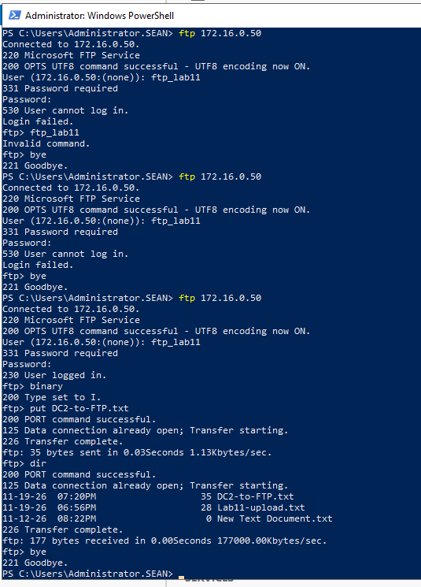
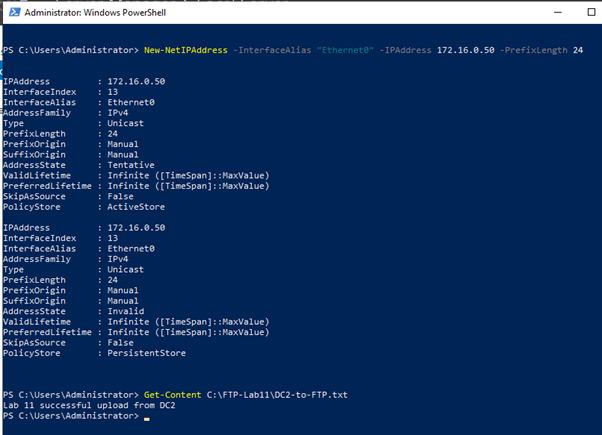

# Lab 10, 11 and 12 Results

Lab 11 is done and its two screenshots are in. Labs 10 and 12 are still to do. The written answers are kept in one place,
`AT1_Written_Answers.md`, and this file tracks the screenshots. Every line that starts
with **AFTER LAB** is a slot that can only be filled from what happens on the day (my screenshots and my
troubleshooting notes). Search for "AFTER LAB" before submitting; none should be left.

---

## Lab 10 Results

Not done yet. The two snips have to match the two demonstration screenshots in the template
(copies in `04_extracted_views/Lab10_template_demonstration_screenshots/`).

**AFTER LAB** Screenshot 10-A: a terminal on my domain-joined Ubuntu client running the `nmap` scan
(`sudo nmap -O <target>`), with my domain name visible in the prompt and the scan report below it.

**AFTER LAB** Screenshot 10-B: the Sguil console on Security Onion, RealTime Events tab, showing the alerts
raised by that scan (`GPL ICMP_INFO PING` and `ET SCAN ...` rows with my scanning machine as the source), and
the Agent Status panel with the agents UP.

### Part 10.1 Troubleshooting report

In `AT1_Written_Answers.md`, last section.

---

## Lab 11 Results

Completed. The FTP server is the Microsoft FTP Service (IIS) on a Windows server at 172.16.0.50, sharing the
folder `C:\FTP-Lab11`. The client is DC2, using the Windows command-line `ftp` client and the FTP user
`ftp_lab11`. The directory listing shows the upload at 7:20 pm on 19 Nov 2026.

**Screenshot 11-1, the client session** (`02_student_work/screenshots/lab11_02_dc2_client_login_upload_dir.png`)

From DC2 I connected to 172.16.0.50 and the server answered `220 Microsoft FTP Service`, which shows the FTP
service is running and reachable. The first two logins were refused (`530 User cannot log in`); the third was
accepted (`230 User logged in`). I set binary mode, uploaded `DC2-to-FTP.txt` with `put`
(`226 Transfer complete`, 35 bytes sent) and listed the folder with `dir`, which shows the uploaded file on
the server.

**Screenshot 11-2, the server side** (`02_student_work/screenshots/lab11_01_ftp_server_ip_and_uploaded_file.png`)

On the FTP server, `New-NetIPAddress` sets the address 172.16.0.50/24 on Ethernet0, and
`Get-Content C:\FTP-Lab11\DC2-to-FTP.txt` reads the file that arrived from DC2: "Lab 11 successful upload
from DC2". The file is the same 35 bytes the client reported sending.

Optional extra, if the teacher wants to see the configuration as well as the service working: the FTP site in
IIS Manager (binding on port 21, physical path `C:\FTP-Lab11`, the authorisation rule for `ftp_lab11`).

(Reference examples from a Linux test server: `05_analysis/reference_snips/lab11_ref1` to `lab11_ref5`.)

### What is the FTP protocol?

Answer 9 in `AT1_Written_Answers.md`.

---

## Lab 12 Results

**AFTER LAB** Screenshot 12-A: the mail server running with my domain and user mailboxes created.

**AFTER LAB** Screenshot 12-B: the DNS records for the mail domain (MX record and the mail server's A record).

**AFTER LAB** Screenshot 12-C: a mail client account set up for one user (incoming and outgoing server settings).

**AFTER LAB** Screenshot 12-D: a message sent from one user and received by another, and the reply coming back.

(Reference examples: `05_analysis/reference_snips/lab12_ref1` to `lab12_ref5`. They are examples only; the
snips that go here are my own.)

### Written questions

| Template question | Answer in `AT1_Written_Answers.md` |
|---|---|
| How AD DS sites implement load balancing across DCs | 7 |
| What is NTP, and how the stratum hierarchy works | 6 |
| What is user authentication | 8 |
| What are Active Directory services | 8 |
